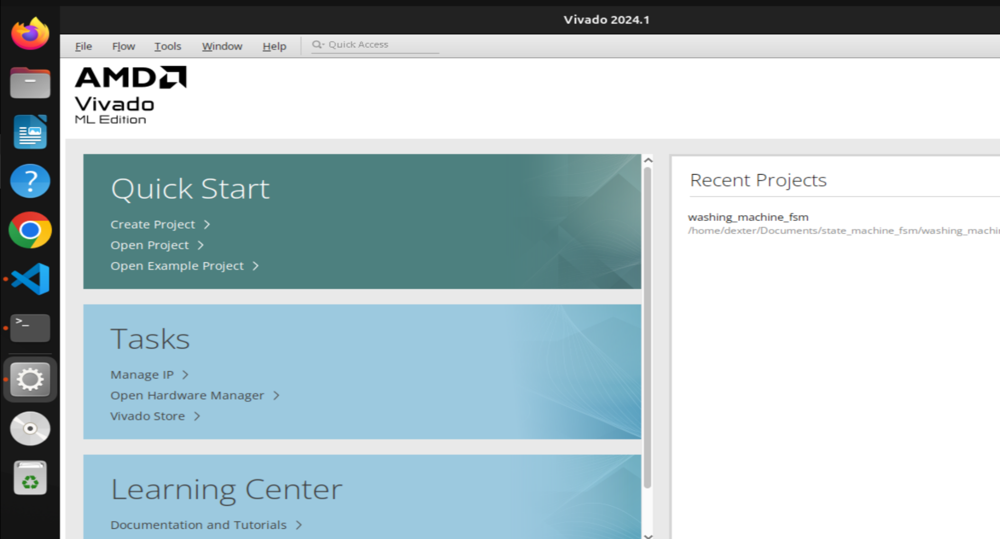
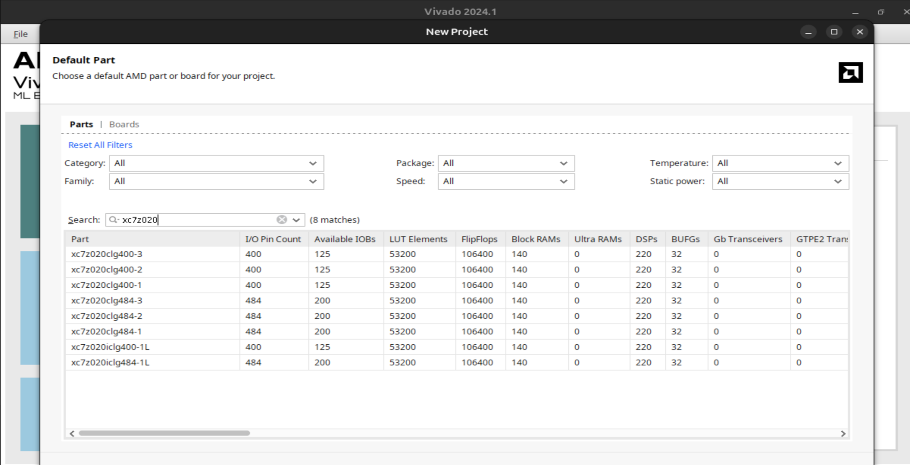

# FPGA Cookbook — PYNQ-Z2 + VHDL + Vivado

This cookbook summarizes the learning path completed on a **PYNQ-Z2** using **Vivado 2024.1** and **VHDL**. The goal is not only to write HDL code, but to understand the complete path from a logical hardware description to a physical behavior that can be observed on the board.



## 1. What We Learn Overall

The exercises are intentionally progressive:

```text
Exercise 0: direct combinational connection
    ↓
Exercise 1: combinational logic using a LUT
    ↓
Exercise 2: sequential logic using a flip-flop + clock
    ↓
Exercise 3: multi-bit binary counter
```

Along the way, we cover fundamental FPGA concepts:

- **input/output ports** (`in`, `out`),
- **combinational logic**,
- **LUTs** (Look-Up Tables),
- **sequential logic**,
- **D flip-flops / FDRE primitives**,
- **clocking**, **BUFG**, and **Clock Enable**,
- **XDC constraints** and physical pin mapping,
- **synthesis**, **implementation**, **bitstream generation**, and **device programming**,
- first **timing** concepts using `create_clock`,
- Vivado project organization and Git version control.

## 2. Hardware Target

The board used is a **PYNQ-Z2**, based on a **Zynq-7020**. Because the PYNQ-Z2 board definition was not installed in Vivado, the FPGA device was selected directly:

```text
xc7z020clg400-1
```



An important consequence is that Vivado knows the FPGA device, but does not automatically know the PYNQ-Z2 board wiring. Therefore, mapping `SW0`, `BTN0`, `LED0`, and other board resources is done through an **XDC** constraint file.

## 3. Vivado Flow Used

For almost every exercise, we follow the same sequence:

```text
Write VHDL
    ↓
Run Synthesis
    ↓
Open Synthesized Design / Schematic
    ↓
Map I/O + XDC constraints
    ↓
Run Implementation
    ↓
Generate Bitstream
    ↓
Hardware Manager
    ↓
Program Device
    ↓
Physical test on the PYNQ-Z2
```

The key distinction is:

```text
VHDL              → describes logical behavior
XDC               → maps VHDL ports to physical FPGA pins
Synthesis         → converts RTL into logic resources
Implementation    → places and routes those resources in the FPGA
Bitstream         → actual configuration loaded into the FPGA
```

## 4. VHDL Is Not a Conventional Software Program

An instruction such as:

```vhdl
led <= sw;
```

does not mean “copy a variable right now.” It describes a permanent hardware relationship:

```text
sw ─────────────────────> led
```

Likewise, a construct such as:

```vhdl
if rising_edge(clk) then
    q <= d;
end if;
```

describes sequential hardware triggered by a clock edge.

## 5. Combinational vs Sequential Logic

### Combinational

```text
input changes
    ↓
output changes immediately
```

Examples:

```vhdl
led <= sw;
led0 <= sw0 and sw1;
```

### Sequential

```text
D changes
    ↓
Q keeps its current value
    ↓
clock edge
    ↓
Q takes the new value
```

This is the foundation of memory elements, registers, counters, and FSMs.

## 6. PYNQ-Z2 Pin Mapping Used in the Exercises

| Board resource | FPGA pin | Standard |
|---|---:|---|
| `SW0` | `M20` | `LVCMOS33` |
| `SW1` | `M19` | `LVCMOS33` |
| `BTN0` | `D19` | `LVCMOS33` |
| `LED0` | `R14` | `LVCMOS33` |
| 125 MHz clock | `H16` | `LVCMOS33` |

For the 125 MHz clock:

```xdc
create_clock -period 8.000 [get_ports clk]
```

because:

```text
T = 1 / 125 MHz = 8 ns
```

## 7. Typical Vivado Project Structure

Vivado creates many generated directories:

```text
exercise_x/
├── exercise_x.cache/
├── exercise_x.hw/
├── exercise_x.ip_user_files/
├── exercise_x.runs/
├── exercise_x.sim/
├── exercise_x.srcs/
│   ├── constrs_1/
│   └── sources_1/
└── exercise_x.xpr
```

The most important files for us are generally:

```text
*.vhd      ← VHDL written by us
*.xdc      ← physical/timing constraints
*.xpr      ← Vivado project file
```

Synthesis results, implementation results, logs, and caches can be regenerated.

## 8. Git: What Should Be Versioned?

The repository was cleaned with a `.gitignore` so that hundreds of generated Vivado files are not tracked.

Minimal example:

```gitignore
**/*.cache/
**/*.hw/
**/*.ip_user_files/
**/*.runs/
**/*.sim/
**/*.gen/

*.jou
*.log
*.str
*.wdb

.vscode/
.DS_Store
```

The goal is to keep `git status` focused on the actual source files:


## 9. Simulation and BDD

VHDL is not limited to FPGA hardware. It can also be **simulated** on a PC using tools such as GHDL, XSim, or Questa/ModelSim.

A BDD architecture around VHDL is therefore entirely possible:

```text
Gherkin .feature
      ↓
BDD runner
      ↓
Python steps / cocotb
      ↓
GHDL / XSim / Questa
      ↓
Simulated VHDL DUT
      ↓
BDD assertions / results
```

The BDD layer does not run inside the FPGA. It orchestrates simulation and checks the behavior of the design.

## 10. Exercise Index

- [Exercise 0 — Switch to LED](exercise_0_switch_led.md)
- [Exercise 1 — AND Logic Gate](exercise_1_logic_gate.md)
- [Exercise 2 — D Flip-Flop / Register with a Real Clock](exercise_2_flip_flop.md)
- [Exercise 3 — 4-bit Binary Counter](exercise_3_counter_4bit.md)
