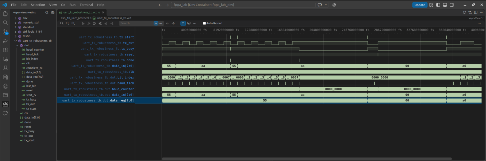
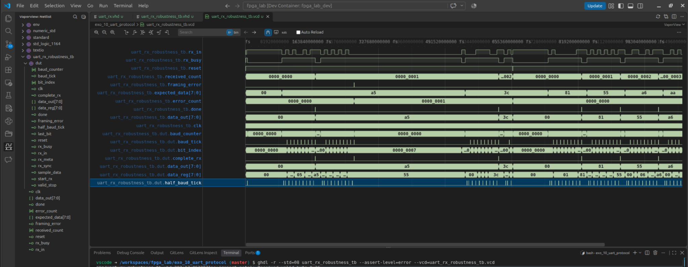
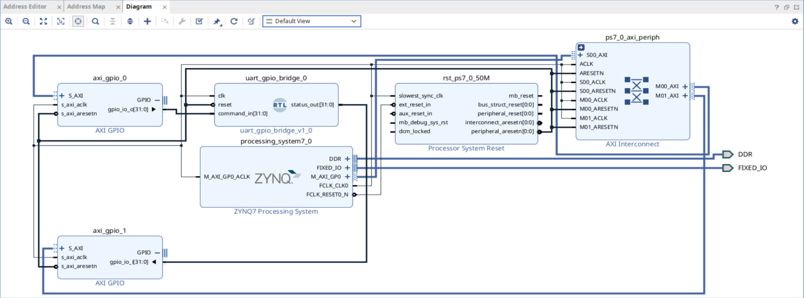
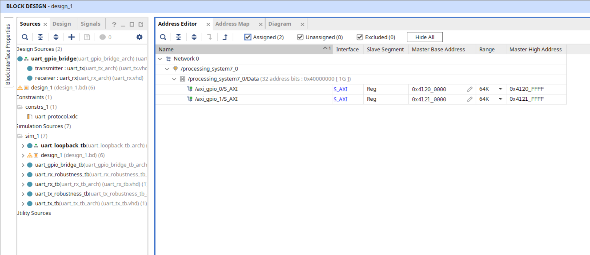

# Exercise 10 — UART Protocol on FPGA
 
**Target:** PYNQ-Z2 — Xilinx Zynq-7020 (`xc7z020clg400-1`)  
**Tools:** VHDL, GHDL (VHDL-2008), Make, VaporView, Vivado 2024.1, Python 3.10.4, PYNQ MMIO, Jupyter, pytest 8.4.2, ipytest 0.14.2  


## 1. Objective

Design a UART transmitter and receiver from scratch, connect them through an internal serial loopback, and expose a reliable software-controlled byte-transfer interface to the ARM processor. Validate the RTL in simulation, implement it on the FPGA and verify the physical PS/PL data path from Python.

The exercise uses 115200 baud, 8N1 (eight data bits, no parity, one stop bit) and a 50 MHz fabric clock. It does not connect an external serial device or use the Zynq PS UART peripheral.

## 2. Concepts practiced

| Concept | Application in this exercise |
| --- | --- |
| Asynchronous serial communication | UART framing, idle high, start low, LSB-first data, stop high |
| Baud-rate generation | Integer clock divider, bit timing and sampling instants |
| Finite-state machines | TX sequencing, RX start validation, receive and error recovery |
| Synchronous RTL | Clocked registers, counters, bit indexes, active-low reset, single-cycle events |
| Clock-domain crossing | Two-flop RX input synchronizer, `ASYNC_REG` attribute, metastability mitigation |
| Data integrity | Latching transmit data, validating stop bit, preserving last valid received data |
| Flow control | Busy signals, one outstanding transfer, request/acknowledgment toggle |
| Hardware/software contract | Packed 32-bit command and status registers, sticky event flags, bit masks |
| PS/PL integration | AXI GP0, AXI GPIO, reset network, memory mapping and PYNQ MMIO |
| Verification | Self-checking testbenches, waveforms, corner cases and exhaustive byte coverage |
| FPGA implementation | Synthesis, placement, routing, XDC constraints, resource use and timing closure |
| Hardware integration testing | Python driver, parameterized pytest cases, reproducible stress tests |
| Performance measurement | End-to-end latency and throughput, distinction from serial line rate |

## 3. UART framing and timing

```text
Idle       Start     Data (LSB first)                        Stop     Idle
  1    |     0    | D0 D1 D2 D3 D4 D5 D6 D7 |      1    |   1
       <---------- 10 bit periods per 8N1 frame ---------->
```

At 50 MHz the clock period is 20 ns. The integer divider is `50_000_000 / 115_200 = 434` clock cycles per bit (integer division). The realized nominal rate is approximately 115207 baud, with a bit period of 8.68 µs. An 8N1 frame therefore takes about 86.8 µs. The ideal useful payload throughput at the requested baud rate is 11520 bytes/s, excluding gaps and software overhead.

The RX validates the start bit near its midpoint, then samples subsequent bits near their centers rather than relying on an edge for each bit. This matters because UART has no separate transmitted clock. The input synchronizer reduces metastability risk but does not eliminate it.

## 4. RTL modules

### `uart_tx.vhd`

- Generics: `CLK_FREQ = 50_000_000`, `BAUD_RATE = 115_200`.
- Interface: `clk`, active-low `reset`, `data_in[7:0]`, `tx_start`, `tx_out`, `tx_busy`, `done`.
- FSM: `IDLE → START → DATA → STOP → IDLE`.
- Latches data at acceptance, serializes LSB first, ignores new requests while busy and emits a completion event at the end of the stop bit.



*Original VaporView capture: TX input changes, latched data, busy, bit counter and completion signals.*

### `uart_rx.vhd`

- Interface: `clk`, active-low `reset`, `rx_in`, `data_out[7:0]`, `rx_busy`, `done`, `framing_error`.
- FSM: `IDLE`, `START`, `DATA`, `STOP`, `WAIT_IDLE`.
- Two-stage synchronizer (`rx_meta`, `rx_sync`) before the receive logic.
- Rejects false starts, checks the stop bit, reports framing errors and waits for idle after an invalid frame.
- Preserves the previous valid output when a frame is rejected.



*Original VaporView capture: serial input, receive data, framing error, completion and recovery behavior.*

### `uart_gpio_bridge.vhd`

- Connects `uart_tx` to `uart_rx` internally, with independent TX/RX baud-rate generics and a common fabric clock.
- Exposes `command_in[31:0]` and `status_out[31:0]` to AXI GPIO.
- Detects a pending command when REQUEST differs from ACK, latches the byte, acknowledges acceptance and generates a TX start pulse.
- Keeps the transaction active until TX and RX finish, or TX finishes with a receive framing error.
- Stores completion and error events in sticky flags so Python can observe short RTL pulses through comparatively slow MMIO polling.
- Clears sticky flags at the next accepted transaction. No FIFO, DMA, interrupt or RTL watchdog is implemented.

## 5. Overall architecture

```text
                 Zynq Processing System (PS)
             ARM Cortex-A9 / Linux / Jupyter
                   Python uart_transfer()
                            |
                         PYNQ MMIO
                            |
                        M_AXI_GP0
                            |
  +-------------------------v--------------------------+
  |             Programmable Logic (PL)               |
  |                   AXI Interconnect                 |
  |                    /             \                 |
  | AXI GPIO 0 (command)              AXI GPIO 1 (status)
  | 0x41200000                         0x41210000      |
  |          |                               ^         |
  |          v                               |         |
  |   +------+-------------------------------+------+  |
  |   |              uart_gpio_bridge               |  |
  |   |     UART TX ---- serial loopback --> UART RX |  |
  |   +---------------------------------------------+  |
  | FCLK_CLK0: 50 MHz; synchronized peripheral reset   |
  +----------------------------------------------------+
```

Vivado IP Integrator connects `processing_system7_0`, `ps7_0_axi_periph`, two single-channel 32-bit AXI GPIOs, `rst_ps7_0_50M` and the RTL bridge. GPIO 0 is all-output and GPIO 1 all-input. The bridge is driven by FCLK_CLK0 and `peripheral_aresetn`. The generated HDL top is `design_1_wrapper`.



*Original block design with PS, AXI interconnect, reset block, GPIO interfaces and UART bridge.*

## 6. Memory map and register protocol

| Peripheral | Base address | Range | GPIO data offset | Direction |
| --- | --- | --- | --- | --- |
| `axi_gpio_0` | `0x41200000` | 64 KiB | `0x00` | PS → PL |
| `axi_gpio_1` | `0x41210000` | 64 KiB | `0x00` | PL → PS |



### COMMAND register

| Bits | Field | Meaning |
| --- | --- | --- |
| 31:9 | Reserved | Write zero |
| 8 | REQUEST | Toggle to request a new byte |
| 7:0 | TX_DATA | Byte to transmit |

### STATUS register

| Bits | Field | Meaning |
| --- | --- | --- |
| 31:15 | Reserved | Zero |
| 14 | FRAMING_ERROR | Sticky receive error |
| 13 | RX_DONE | Sticky RX completion |
| 12 | TX_DONE | Sticky TX completion |
| 11 | RX_BUSY | Receiver busy |
| 10 | TX_BUSY | Transmitter busy |
| 9 | ACTIVE | Transaction in progress |
| 8 | ACK | Accepted request toggle |
| 7:0 | RX_DATA | Last received byte |

### Transaction sequence

1. Read current status and command; verify idle state, no error and no pending request.
2. Compute the new REQUEST as the inverse of ACK and write it together with TX_DATA.
3. The bridge accepts the request, updates ACK, clears previous sticky flags and starts transmission.
4. Poll until ACK matches REQUEST, all busy flags are clear and both completion flags are set; fail on framing error or timeout.
5. Read RX_DATA and compare it to the transmitted byte.

ACK means *accepted*, not *completed*. Keeping the same REQUEST does not trigger a second transmission. A reset must leave the command and bridge in a consistent toggle state.

Observed initial manual transactions, starting with ACK = 0:

| Byte | COMMAND | Final STATUS | Result |
| --- | --- | --- | --- |
| `0xA6` | `0x000001A6` | `0x000031A6` | PASS |
| `0x55` | `0x00000055` | `0x00003055` | PASS |

## 7. RTL simulation and verification

GHDL was used with VHDL-2008 and self-checking testbenches. VCD waveforms were inspected in VaporView. The Makefile centralizes compilation, elaboration, execution and waveform generation.

```bash
make test
make wave TB=uart_gpio_bridge_tb
make clean
```

| Testbench | Scenario IDs | Coverage |
| --- | --- | --- |
| `uart_tx_tb` | TC01–TC08 | Reset, idle, frame serialization and representative bytes |
| `uart_tx_robustness_tb` | TC09–TC12 | Input changes during TX, requests while busy, reset and recovery |
| `uart_rx_tb` | TC13–TC22 | Reset, idle, frame reception, successive and back-to-back frames |
| `uart_rx_robustness_tb` | TC23–TC30 | False start, invalid stop, output preservation, stuck-low line, recovery, reset, ±2% baud mismatch |
| `uart_loopback_tb` | TC31–TC39 | Full byte range, back-to-back transfers, sequence integrity, completion counts, reset/recovery, baud mismatch |
| `uart_gpio_bridge_tb` | TC40–TC52 | Command decoding, toggle/ACK, no repeated request, sticky flags, latching, status mapping, reset and recovery |

All 52 numbered scenarios were covered by the successful simulation runs. TC39 was skipped in the nominal loopback run and exercised in the separate baud-mismatch runs. TC43 checks absence of repeated transmission rather than directly measuring the start pulse width. Bridge-level injected framing errors were not exercised.

## 8. Vivado synthesis, implementation and timing

The bridge was first synthesized and routed as a standalone RTL design using a 20 ns clock constraint. The final integrated design uses the PS-generated fabric clock; the standalone XDC was disabled to avoid applying its clock constraint to the wrong top-level port. The module reference was added to IP Integrator with the bridge file marked VHDL (TX/RX retained VHDL-2008), then the HDL wrapper was generated and the complete design synthesized and implemented.

### Resource utilization

| Metric | Standalone routed bridge | Integrated synthesized | Integrated routed |
| --- | ---: | ---: | ---: |
| LUTs | 59 | 806 | 719 (1.35%) |
| Flip-flops | 82 | 1290 | 1239 (1.16%) |
| Slices | 28 | — | 332 |
| BRAM | 0 | 0 | 0 |
| DSP | 0 | 0 | 0 |

The final routed design uses 657 logic LUTs and 62 SRLs, one BUFG and no external PL bonded I/O. The PS uses its fixed I/O pins. Most logic cost comes from the AXI interconnect and GPIOs, not the UART datapath: the bridge accounts for 59 LUTs and 82 registers, versus 491 LUTs and 648 registers for the AXI interconnect.

### Final routed timing (50 MHz)

| Metric | Result |
| --- | ---: |
| Clock period | 20.000 ns |
| WNS (setup) | +13.375 ns |
| WHS (hold) | +0.077 ns |
| TNS / THS | 0 / 0 ns |
| Worst pulse-width slack | +9.020 ns |
| Failing setup/hold endpoints | 0 / 0 |
| DRC violations | 0 |
| Methodology violations | 0 |

Timing constraints were met. The critical setup path is inside the AXI interconnect, not the UART. These are results of the routed Vivado report, not a measurement of the maximum operating frequency on hardware.

## 9. Hardware bring-up and debugging

The bitstream was generated and programmed on the physical PYNQ-Z2 using Vivado. Linux/Jupyter remained responsible for software control.

Two integration issues were resolved:

- **Actual fabric clock:** Python initially reported FCLK0 = 100 MHz although the design was configured for 50 MHz. Programming PL through Vivado did not apply the desired PS clock configuration. Setting `Clocks.fclk0_mhz = 50.0` and verifying it before MMIO restored the expected timing. A shared-clock loopback alone would not have detected the baud-rate error.
- **Stale software status:** the second manual transfer initially failed a Python assertion because the cached status remained `0x000031A6`. A fresh MMIO read returned `0x00003055`, proving the second transfer was correct. The reusable driver now reads status locally instead of depending on notebook variables left over from another cell.

A Jupyter kernel restart does not reset PL registers. The refactored notebook therefore checks readiness and derives the next toggle from hardware ACK rather than assuming an all-zero status.

## 10. Python notebook and parameterized tests

Notebook: [`notebooks/uart_test_bench.ipynb`](https://github.com/dexterBEN/fpga_lab/blob/master/exo_10_uart_protocol/notebooks/uart_test_bench.ipynb).

The notebook is self-contained: prerequisites, imports/constants, clock/MMIO setup, `read_status()`, `uart_transfer()`, readiness tests, handshake tests, parameterized cases, stress testing, performance and scope. Comments and test labels are in English.

Dependencies (verified on the board): pytest 8.4.2 and ipytest 0.14.2, Python 3.10.4.

```python
%pip install "pytest>=7,<9" "ipytest==0.14.2"
```

Configure `ipytest.autoconfig(raise_on_error=True, addopts=())` in the setup cell. A typical test cell is:

```python
%%ipytest -v -x

@pytest.mark.parametrize("data", range(256),
                         ids=lambda data: f"0x{data:02X}")
def test_uart_exhaustive(data):
    assert uart_transfer(data) == data
```

The decorator creates one independently reported case per byte, analogous to data-driven tests in MSTest. `-x` stops the current test session after the first failure. The test suite is sequential because it shares a physical bridge; the cases must not drive the same registers concurrently. These are hardware integration tests, not isolated software unit tests.

### Recorded hardware results

| Test group | Passed | pytest session duration |
| --- | ---: | ---: |
| Clock and bridge readiness | 2/2 | 0.24 s |
| Toggle handshake and five representative patterns | 6/6 | 0.37 s |
| Exhaustive byte values (`0x00`–`0xFF`) | 256/256 | 9.09 s |
| Stress test (10,000 pseudo-random transfers; seed 42) | 1/1 | 2.12 s |
| **Total** | **265/265** | **11.82 s (sum)** |

The separate performance cell additionally transfers all 256 byte values. The complete recorded notebook run therefore executes 10,519 successful UART transactions (2 handshake + 5 patterns + 256 exhaustive + 10,000 stress + 256 performance). No errors were detected.

Actual output excerpt from the saved notebook (text, not a reconstructed screenshot):

```text
Passed: 10000/10000
Execution time: 1.9564 s
Transfers per second: 5111.46
PASSED
```

## 11. End-to-end performance

| Metric | Recorded / derived value |
| --- | ---: |
| Original manual-loop exhaustive test | 256 transfers in 0.0510 s |
| Refactored timed loop | 256 transfers in 0.0520 s |
| Refactored average latency | 203.09 µs |
| Refactored throughput | 4923.81 bytes/s |
| Stress-loop throughput | 5111.46 transfers/s |
| Ideal 8N1 frame duration | 86.81 µs |
| Ideal UART payload throughput | 11520 bytes/s |

The measured latency includes Python, MMIO, AXI, bridge synchronization, polling and the UART frame. It is not a direct physical baud-rate measurement. The performance loop intentionally excludes per-case pytest reporting overhead; the 9.09 s exhaustive pytest session should not be interpreted as FPGA transfer time. The software serializes transactions without FIFO buffering, which limits aggregate throughput.

## 12. Validation scope and possible extensions

Completed: RTL design, 52 scenario IDs in GHDL, synthesis, integrated placement/routing, timing closure, programming, MMIO communication, both toggle directions, all byte values, repeated transfers and performance measurement.

Not validated on physical external UART pins: electrical interface, actual baud rate with an instrument, independent clock mismatch, hardware framing-error injection. A Python polling timeout cannot interrupt a blocked AXI access. The driver assumes a single controller and one outstanding transfer. An RTL watchdog, FIFO, interrupt-driven communication, DMA and external serial tests are possible future exercises, not requirements for this internal loopback.

## 13. Archive contents and evidence

```text
exo_10_uart_protocol_documentation/
├── README.md
└── assets/
    ├── uart_tx_simulation.png
    ├── uart_rx_simulation.png
    ├── vivado_block_design.png
    └── vivado_address_map.png
```

The four screenshots are original conversation attachments, selected to document the RTL waveforms and PS/PL integration. Hardware results are reproduced as text from the recorded notebook outputs; no original hardware-test or programming screenshot was available among the selected UART captures. No artificial screenshot has been created. Host virtualization troubleshooting is deliberately excluded. The archive is documentation only; RTL, Vivado files and notebook sources remain in the project repository.

Evidence used: conversation GHDL `make test` log (24 Nov 2026), standalone and integrated Vivado reports (24 Nov 2026, including final routed DRC and methodology reports), original waveform and block-design screenshots, manual MMIO diagnostics, and the saved executed notebook provided as text on 27 Nov 2026.