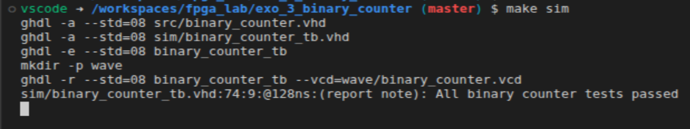
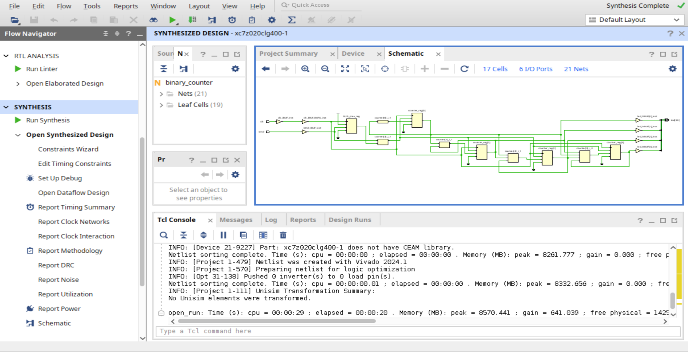
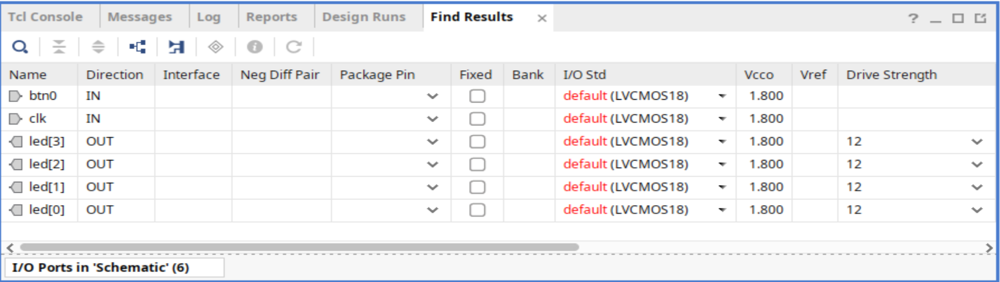
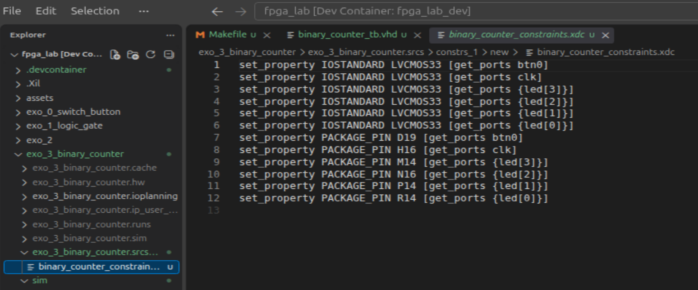
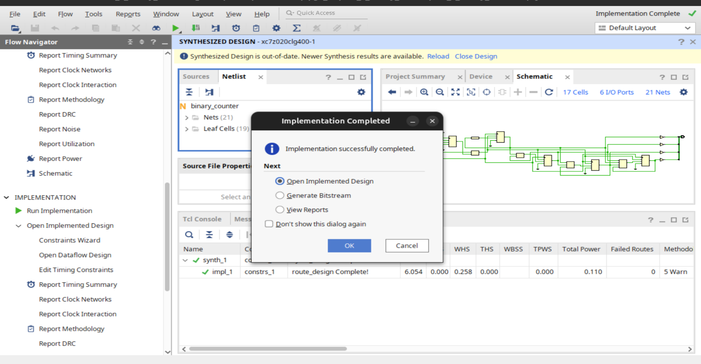

# FPGA Lab — Exercise 3: 4-bit Binary Counter

## 1. Lab objective

The goal of this exercise is to build a **4-bit synchronous binary counter** in VHDL, then:

1. simulate it with **GHDL**;
2. inspect its waveforms with **GTKWave**;
3. validate it automatically with **assertions**;
4. synthesize and implement it in **Vivado**;
5. map it to the physical resources of the **PYNQ-Z2**;
6. program the FPGA and verify the result on the board LEDs.

The expected behavior is simple:

- one press on `BTN0` causes **one increment**;
- the counter value is displayed on `LED3..LED0`;
- the counter runs from `0000` to `1111`, then wraps back to `0000`.

---

## 2. Expected functional behavior

The counter is 4 bits wide, so it has 16 possible states.

| Decimal value | LED3 | LED2 | LED1 | LED0 | Binary |
|---:|---:|---:|---:|---:|:---:|
| 0  | 0 | 0 | 0 | 0 | `0000` |
| 1  | 0 | 0 | 0 | 1 | `0001` |
| 2  | 0 | 0 | 1 | 0 | `0010` |
| 3  | 0 | 0 | 1 | 1 | `0011` |
| 4  | 0 | 1 | 0 | 0 | `0100` |
| ... | ... | ... | ... | ... | ... |
| 15 | 1 | 1 | 1 | 1 | `1111` |
| wrap | 0 | 0 | 0 | 0 | `0000` |

Functional diagram:

```text
                   +----------------------+
CLK 125 MHz ------>|                      |
                   |    4-bit counter     |----> LED[3:0]
BTN0 ------------->|                      |
                   +----------------------+
```

The push button is **not used as the clock**.  
It is sampled by the real 125 MHz board clock.

---

## 3. Concepts learned

### 3.1 Combinational vs sequential logic

The earlier exercises mostly dealt with combinational logic:

```text
input changes
    ↓
output changes immediately
```

A counter is different because it has **internal state**:

```text
current state
    ↓
clock edge
    ↓
next state
```

This requires registers / flip-flops inside the FPGA.

---

### 3.2 Using a `process(clk)`

The counter is sequential logic, so the natural VHDL structure is:

```vhdl
process(clk)
begin
    if rising_edge(clk) then
        -- sequential logic
    end if;
end process;
```

`rising_edge(clk)` means:

> update the registers only on a rising edge of the clock.

---

### 3.3 Using a real FPGA clock

In the previous exercise, using `BTN0` directly as a clock caused a Vivado placement error:

```text
Poor placement for routing between an IO pin and BUFG
```

The reason is that an FPGA clock should not be treated like an ordinary input pin.

For this exercise, the PYNQ-Z2 system clock is used:

```text
CLK 125 MHz
PACKAGE_PIN H16
period = 8 ns
```

The corresponding timing constraint is:

```xdc
create_clock -period 8.000 [get_ports clk]
```

---

### 3.4 `unsigned` and `numeric_std`

A counter represents a numeric value.

We therefore use:

```vhdl
use IEEE.NUMERIC_STD.ALL;
```

and declare:

```vhdl
signal counter : unsigned(3 downto 0) := (others => '0');
```

This allows natural arithmetic:

```vhdl
counter <= counter + 1;
```

instead of manually writing Boolean equations for every bit.

---

### 3.5 VHDL buses

Instead of declaring four separate outputs:

```vhdl
led0 : out STD_LOGIC;
led1 : out STD_LOGIC;
led2 : out STD_LOGIC;
led3 : out STD_LOGIC;
```

we use one bus:

```vhdl
led : out STD_LOGIC_VECTOR(3 downto 0)
```

This is a better representation of a 4-bit binary value.

```text
led(3) led(2) led(1) led(0)
  MSB                     LSB
```

---

### 3.6 Detecting a rising edge on `BTN0`

Checking only:

```vhdl
if btn0 = '1' then
```

would not implement “one press = one increment”.

The FPGA clock runs at 125 MHz.  
If the button stayed high for 100 ms, the counter could otherwise increment millions of times.

The solution is to remember the previous button value:

```vhdl
signal btn0_prev : STD_LOGIC := '0';
```

and detect:

```vhdl
if btn0 = '1' and btn0_prev = '0' then
```

This represents a logical rising edge:

```text
previous state = 0
current state  = 1
```

Example:

```text
btn0
____----________----________
    ^           ^
    |           |
  event       event
```

---

## 4. Counter VHDL code

```vhdl
library IEEE;
use IEEE.STD_LOGIC_1164.ALL;
use IEEE.NUMERIC_STD.ALL;

entity binary_counter is
    port (
        clk  : in  STD_LOGIC;
        btn0 : in  STD_LOGIC;
        led  : out STD_LOGIC_VECTOR(3 downto 0)
    );
end binary_counter;

architecture binary_counter_arch of binary_counter is

    signal counter   : unsigned(3 downto 0) := (others => '0');
    signal btn0_prev : STD_LOGIC := '0';

begin

    process(clk)
    begin
        if rising_edge(clk) then

            btn0_prev <= btn0;

            if btn0 = '1' and btn0_prev = '0' then
                counter <= counter + 1;
            end if;

        end if;
    end process;

    led <= std_logic_vector(counter);

end binary_counter_arch;
```

---

## 5. How the design works

At each rising edge of `clk`:

```text
1. the current BTN0 value is sampled
2. BTN0 is compared with btn0_prev
3. if BTN0 has just changed from 0 to 1:
       counter = counter + 1
4. the LED bus displays counter
```

Simplified architecture:

```text
                   +----------------------+
BTN0 ------------->| edge detection       |
                   +----------+-----------+
                              |
                              v
CLK -----------> [ counter registers ] ---> counter[3:0]
                              |
                              v
                           LED[3:0]
```

---

## 6. Project structure

A clean project layout was used:

```text
fpga_lab/
├── .devcontainer/
│   ├── Dockerfile
│   └── devcontainer.json
│
└── exo_3_binary_counter/
    ├── src/
    │   └── binary_counter.vhd
    ├── sim/
    │   └── binary_counter_tb.vhd
    ├── wave/
    │   └── binary_counter.vcd
    ├── Makefile
    └── exo_3_binary_counter.xpr
```

The Dev Container is shared by the FPGA lab exercises.

---

## 7. Simulation environment

The main tools are:

```text
GHDL     -> VHDL compilation / simulation
GTKWave  -> waveform visualization
Make     -> command automation
```

The Dev Container keeps the simulation toolchain separate from the Ubuntu VM and from Vivado.

---

## 8. Testbench

The testbench instantiates the DUT:

```vhdl
dut : entity work.binary_counter
    port map (
        clk  => clk,
        btn0 => btn0,
        led  => led
    );
```

### Clock generation

125 MHz corresponds to:

```text
T = 1 / 125 MHz = 8 ns
```

So the testbench generates:

```vhdl
clk_process : process
begin
    clk <= '0';
    wait for 4 ns;

    clk <= '1';
    wait for 4 ns;
end process;
```

---

## 9. Button stimulus

The testbench simulates several button presses:

```vhdl
btn0 <= '0';
wait for 20 ns;

btn0 <= '1';
wait for 16 ns;

btn0 <= '0';
wait for 20 ns;
```

The same pattern is repeated several times.

---

## 10. Assertions

Assertions automatically verify the expected output.

Example:

```vhdl
assert led = "0001"
    report "ERROR: after first press, counter should be 0001"
    severity error;
```

Then:

```vhdl
assert led = "0010"
    report "ERROR: after second press, counter should be 0010"
    severity error;
```

At the end:

```vhdl
report "All binary counter tests passed"
    severity note;

finish;
```

Observed result:

```text
All binary counter tests passed
simulation finished @128ns
```

Screenshot:



---

## 11. Makefile

The Makefile automates the GHDL workflow:

```make
TOP = binary_counter_tb
VCD = wave/binary_counter.vcd

SRC = src/binary_counter.vhd
TB  = sim/binary_counter_tb.vhd

analyze:
	ghdl -a --std=08 $(SRC)
	ghdl -a --std=08 $(TB)

elaborate: analyze
	ghdl -e --std=08 $(TOP)

sim: elaborate
	mkdir -p wave
	ghdl -r --std=08 $(TOP) --vcd=$(VCD)

wave: sim
	gtkwave $(VCD)

clean:
	rm -f *.cf
	rm -f wave/*.vcd
```

Usage:

```bash
make sim
```

or:

```bash
make wave
```

---

## 12. VCD analysis

The VCD file showed:

```text
0 ns    -> 0000
20 ns   -> 0001
60 ns   -> 0010
92 ns   -> 0011
```

The important observation is that the counter does **not** increment at every `clk` rising edge while `btn0` stays high.

It increments only when a new button rising edge is detected.

---

## 13. Moving to Vivado

After simulation validation:

```text
GHDL simulation
      ↓
VCD / GTKWave
      ↓
Assertions
      ↓
Vivado
      ↓
Synthesis
      ↓
Implementation
      ↓
Bitstream
      ↓
Program Device
```

---

## 14. Vivado synthesis

Synthesis completed successfully.

The synthesized schematic is more complex than in the earlier exercises. It contains:

- input buffers;
- a global clock network;
- registers;
- increment logic;
- edge-detection logic;
- output buffers.

Screenshot:



Conceptually:

```text
CLK ---> IBUF ---> BUFG --------------------+
                                             |
BTN0 ---> IBUF ---> edge-detection logic     |
                         |                    |
                         v                    v
                    +-----------------------------+
                    | counter registers + logic   |
                    +---------------+-------------+
                                    |
                               counter[3:0]
                                    |
                              OBUF x4
                                    |
                              LED[3:0]
```

---

## 15. Physical XDC constraints

The XDC file maps the VHDL ports to physical PYNQ-Z2 pins.

Mapping used:

| VHDL port | Board resource | Pin |
|---|---|---|
| `clk` | 125 MHz clock | `H16` |
| `btn0` | BTN0 | `D19` |
| `led[0]` | LED0 | `R14` |
| `led[1]` | LED1 | `P14` |
| `led[2]` | LED2 | `N16` |
| `led[3]` | LED3 | `M14` |

All I/Os use:

```text
LVCMOS33
```

I/O Ports screenshot:



---

## 16. Final XDC

```xdc
set_property IOSTANDARD LVCMOS33 [get_ports btn0]
set_property IOSTANDARD LVCMOS33 [get_ports clk]
set_property IOSTANDARD LVCMOS33 [get_ports {led[3]}]
set_property IOSTANDARD LVCMOS33 [get_ports {led[2]}]
set_property IOSTANDARD LVCMOS33 [get_ports {led[1]}]
set_property IOSTANDARD LVCMOS33 [get_ports {led[0]}]

set_property PACKAGE_PIN D19 [get_ports btn0]
set_property PACKAGE_PIN H16 [get_ports clk]
set_property PACKAGE_PIN M14 [get_ports {led[3]}]
set_property PACKAGE_PIN N16 [get_ports {led[2]}]
set_property PACKAGE_PIN P14 [get_ports {led[1]}]
set_property PACKAGE_PIN R14 [get_ports {led[0]}]

create_clock -period 8.000 [get_ports clk]
```

Screenshot:



---

## 17. Implementation

After adding the XDC constraints:

```text
Run Implementation
```

completed successfully.

Screenshot:



Then:

```text
Generate Bitstream
→ Open Hardware Manager
→ Program Device
```

---

## 18. Validation on the PYNQ-Z2

The counter was tested directly on the board.

Observed behavior:

```text
BTN0 press #1 -> 0001
BTN0 press #2 -> 0010
BTN0 press #3 -> 0011
BTN0 press #4 -> 0100
...
```

The hardware behavior matched the simulation.

---

## 19. Problems encountered

### 19.1 Simulation never stopped

The first version of the testbench ended with:

```vhdl
wait;
```

while the clock process ran forever.

GHDL therefore never returned to the shell.

Temporary solution:

```bash
--stop-time=200ns
```

Cleaner VHDL-2008 solution:

```vhdl
library std;
use std.env.all;
```

and:

```vhdl
finish;
```

---

### 19.2 Dev Container file permissions

Some files were created as `root`.

Example:

```text
-rw-r--r-- 1 root root Makefile
```

VS Code could not save them from inside the container.

Fix:

```bash
sudo chown -R vscode:vscode /workspaces/fpga_lab/exo_3_binary_counter
```

Afterward, the files belonged to:

```text
vscode vscode
```

---

### 19.3 Mechanical push-button bounce

The current design detects digital transitions on `BTN0`, but a real mechanical button may bounce:

```text
physical press

0 ----1-0-1-0-1--------1
      ^ ^ ^ ^ ^
       bounce
```

A single physical press may therefore generate several electrical rising edges.

The counter appeared to work correctly during the quick hardware test, but a more robust version should include **debouncing**.

---

## 20. Why Karnaugh maps were not required

A counter can be designed manually from:

- state tables;
- D flip-flops;
- Karnaugh maps;
- Boolean equations.

For example, a 2-bit counter:

```text
00 -> 01 -> 10 -> 11 -> 00
```

can lead to:

```text
Q0+ = NOT Q0
Q1+ = Q1 XOR Q0
```

However, for a 4-bit counter, VHDL lets us express the intent directly:

```vhdl
counter <= counter + 1;
```

Vivado then synthesizes the equivalent logic.

Karnaugh maps remain useful for understanding combinational logic and minimization, but they are not mandatory for implementing this counter in HDL.

---

## 21. Skills validated

By the end of this exercise, the following topics were practiced:

```text
✓ Vivado project creation
✓ manually managed VHDL source file
✓ src / sim / wave project layout
✓ STD_LOGIC_VECTOR bus
✓ unsigned type
✓ numeric_std
✓ 4-bit counter
✓ synchronous process
✓ rising_edge(clk)
✓ edge detection
✓ previous-state storage
✓ VHDL testbench
✓ GHDL
✓ GTKWave / VCD
✓ assertions
✓ std.env.finish
✓ Makefile
✓ Dev Container
✓ Vivado synthesis
✓ reading a synthesized schematic
✓ XDC constraints
✓ clock timing constraint
✓ implementation
✓ bitstream generation
✓ PYNQ-Z2 programming
✓ hardware validation
```

---

## 22. Possible improvements

### Button debouncing

Add a time filter so that one physical button press generates exactly one logical event.

### Reset input

Add:

```vhdl
reset : in STD_LOGIC;
```

to reset the counter to:

```text
0000
```

without reprogramming the FPGA.

### Modulo-N counter

For example:

```text
0 -> 1 -> 2 -> 3 -> 4 -> 5 -> 0
```

### Up/down counter

Add a switch:

```text
SW0 = 0 -> count up
SW0 = 1 -> count down
```

### Seven-segment display

Display the counter value directly as a hexadecimal or decimal digit.

### BDD / Gherkin

The testbench assertions are already a first step toward higher-level automated verification.

A future architecture could look like:

```text
Gherkin
   ↓
BDD runner
   ↓
cocotb / GHDL
   ↓
VHDL DUT
   ↓
assertions / results
```

---

## 23. Summary

This exercise is an important step in the FPGA learning path.

The previous exercises introduced:

```text
Exercise 0 -> direct combinational connection
Exercise 1 -> LUT / logic gate
Exercise 2 -> register / flip-flop / clock enable
```

Exercise 3 adds:

```text
internal state
+
arithmetic
+
buses
+
edge detection
+
testbench
+
automatic verification
+
full FPGA workflow
```

The final result is a real 4-bit binary counter running inside the programmable logic of the PYNQ-Z2 and displayed on the board LEDs.
