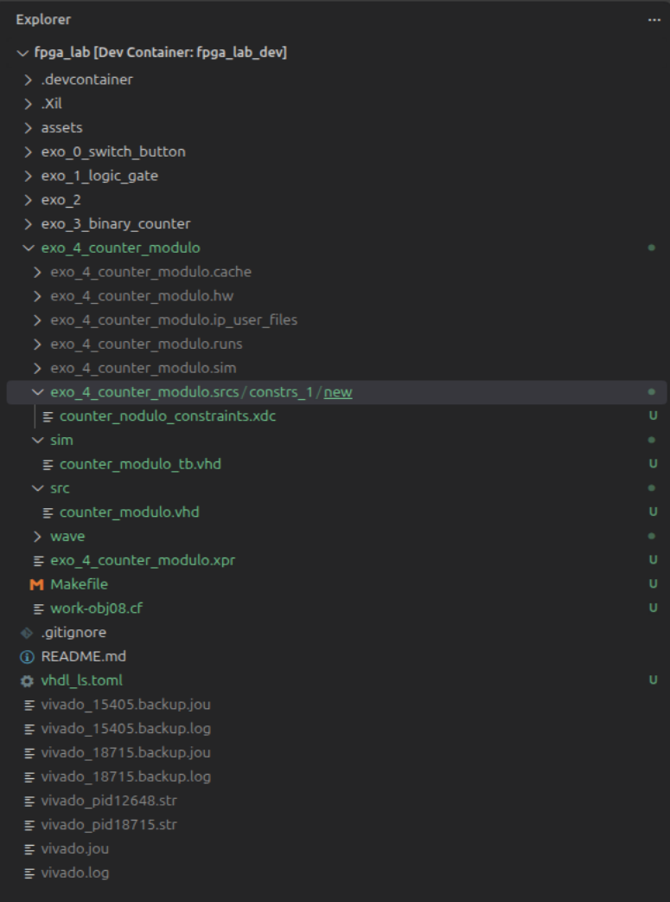
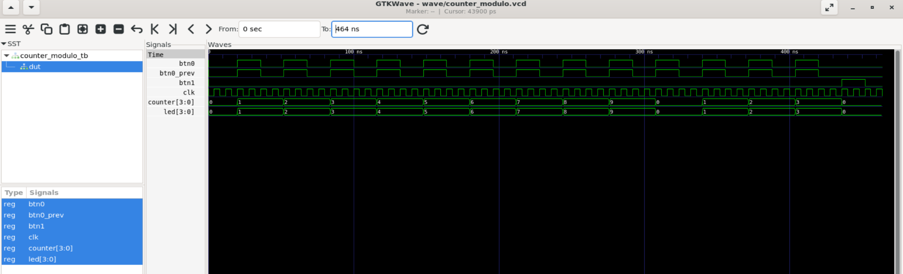
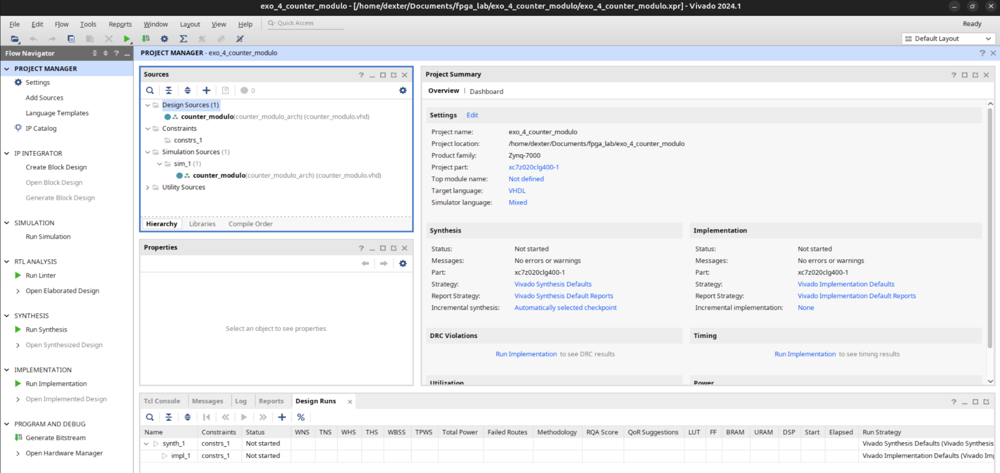
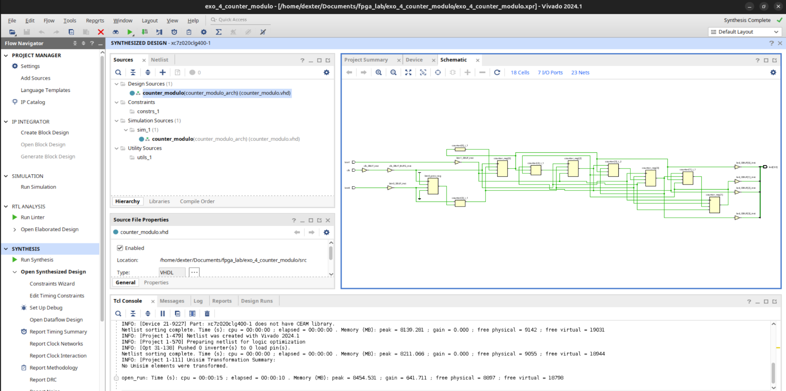
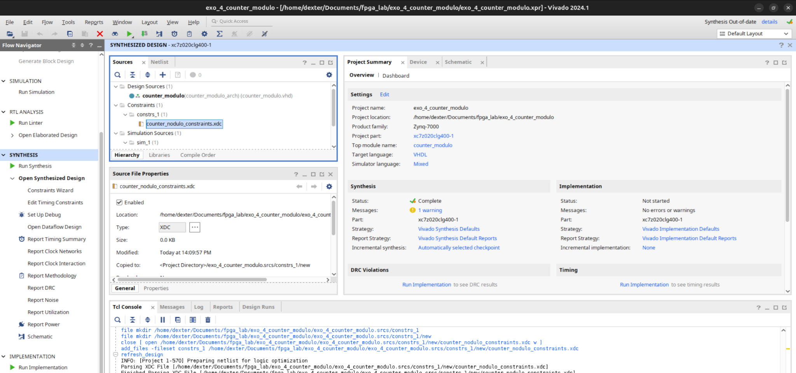
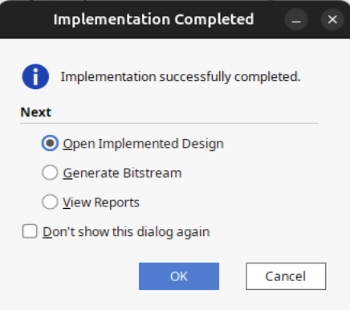
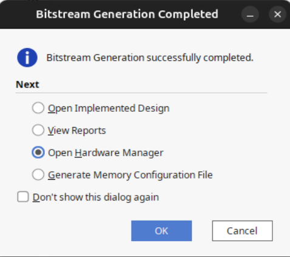

# FPGA Lab — Exercise 4: Modulo-10 Counter with Reset

## 1. Objective

The goal of this exercise is to evolve the 4-bit binary counter from Exercise 3 into a **modulo-10 counter** with a **synchronous reset**.

```text
BTN0 : increment
BTN1 : reset
CLK  : 125 MHz clock
LED[3:0] : counter display
```

Expected sequence:

```text
0 → 1 → 2 → 3 → 4 → 5 → 6 → 7 → 8 → 9 → 0
```

And at any time:

```text
BTN1 = 1
    ↓
counter = 0
```

---

## 2. What changes compared with Exercise 3

Exercise 3 introduced the 4-bit counter, `unsigned`, `numeric_std`, BTN0 edge detection, assertions, and GTKWave.

Exercise 4 adds:

- a limit condition;
- modulo-10 wrap-around;
- a synchronous reset;
- priority between reset and increment.

This is a small increase in complexity without changing the overall architecture.

---

## 3. Functional architecture

```text
                         +----------------------+
BTN1 ------------------>| RESET                |
                         |                      |
BTN0 → edge detector --->| ENABLE   Counter     |----> LED[3:0]
                         |          modulo 10   |
CLK 125 MHz ------------>| CLK                  |
                         +----------------------+
```

Logical priority:

```text
on every rising_edge(clk)

    if BTN1 = 1
        counter = 0

    else if a new BTN0 rising edge is detected
        if counter = 9
            counter = 0
        else
            counter = counter + 1
```

---

## 4. VHDL code

```vhdl
library IEEE;
use IEEE.STD_LOGIC_1164.ALL;
use IEEE.NUMERIC_STD.ALL;

entity counter_modulo is
    port (
        clk  : in  STD_LOGIC;
        btn1 : in  STD_LOGIC;
        btn0 : in  STD_LOGIC;
        led  : out STD_LOGIC_VECTOR(3 downto 0)
    );
end counter_modulo;

architecture counter_modulo_arch of counter_modulo is

    signal counter   : unsigned(3 downto 0) := (others => '0');
    signal btn0_prev : STD_LOGIC := '0';

begin

    process(clk)
    begin
        if rising_edge(clk) then

            btn0_prev <= btn0;

            if btn1 = '1' then
                counter <= "0000";

            elsif btn0 = '1' and btn0_prev = '0' then

                if counter = "1001" then
                    counter <= "0000";
                else
                    counter <= counter + 1;
                end if;

            end if;

        end if;
    end process;

    led <= std_logic_vector(counter);

end counter_modulo_arch;
```

---

## 5. Concepts learned

### Modulo-10 counter

A standard 4-bit counter counts from 0 to 15. Here, the counter is forced back to zero after 9:

```vhdl
if counter = "1001" then
    counter <= "0000";
```

`1001₂ = 9₁₀`.

### Synchronous reset

The reset is evaluated inside `rising_edge(clk)`:

```vhdl
if rising_edge(clk) then
    if btn1 = '1' then
        counter <= "0000";
```

The reset is therefore synchronized with the clock.

### Priority

The structure:

```vhdl
if btn1 = '1' then
    ...
elsif btn0 = '1' and btn0_prev = '0' then
    ...
end if;
```

expresses:

```text
RESET > INCREMENT
```

If BTN0 and BTN1 are active at the same time, reset wins.

### BTN0 edge detection

The previous BTN0 state is stored:

```vhdl
signal btn0_prev : STD_LOGIC := '0';
```

and a rising edge is detected with:

```vhdl
btn0 = '1' and btn0_prev = '0'
```

---

## 6. Project structure

```text
exo_4_counter_modulo/
├── src/
│   └── counter_modulo.vhd
├── sim/
│   └── counter_modulo_tb.vhd
├── wave/
│   └── counter_modulo.vcd
├── Makefile
├── exo_4_counter_modulo.xpr
└── exo_4_counter_modulo.srcs/
    └── constrs_1/
        └── new/
            └── counter_modulo_constraints.xdc
```



---

## 7. Simulation with GHDL and GTKWave

The flow is the same as in Exercise 3:

```text
VHDL
→ GHDL
→ VCD
→ GTKWave
→ assertions
```

### Makefile

```make
TOP = counter_modulo_tb
VCD = wave/counter_modulo.vcd

SRC = src/counter_modulo.vhd
TB  = sim/counter_modulo_tb.vhd

analyze:
	ghdl -a --std=08 $(SRC)
	ghdl -a --std=08 $(TB)

elaborate: analyze
	ghdl -e --std=08 $(TOP)

sim: elaborate
	mkdir -p wave
	ghdl -r --std=08 $(TOP) --vcd=$(VCD)

wave: sim
	gtkwave $(VCD)

clean:
	rm -f *.cf
	rm -f wave/*.vcd
```

Commands:

```bash
make sim
make wave
```

---

## 8. Testbench

The testbench verifies:

```text
initial state             → 0000
10 BTN0 presses           → back to 0000
3 additional BTN0 presses → 0011
BTN1                      → reset to 0000
```

Observed result:

```text
All counter modulo tests passed
simulation finished @468ns
```

---

## 9. GTKWave validation

GTKWave shows:

```text
0 → 1 → 2 → 3 → 4 → 5 → 6 → 7 → 8 → 9 → 0
```

Then:

```text
0 → 1 → 2 → 3
BTN1 = 1
→ 0
```



The simulation also confirms that `led[3:0]` follows `counter[3:0]`.

---

## 10. Adding sources to Vivado

The file `src/counter_modulo.vhd` is added as a **Design Source**.



The project uses VHDL as its target language.

---

## 11. Vivado synthesis

Synthesis completes successfully.

The synthesized schematic contains:

- BTN0 / BTN1 inputs;
- clock network;
- the `btn0_prev` register;
- counter registers;
- increment logic;
- comparison logic for 9;
- reset logic;
- LED outputs.



Simplified schematic:

```text
                     +------------------+
BTN0 ---> IBUF ----->| edge detection   |
                     +--------+---------+
                              |
                              v
CLK ---> IBUF ---> BUFG ---> counter registers
                              ^      |
                              |      +--> +1
BTN1 ---> IBUF ---------------+      |
                                     +--> compare 9
                                     |
                                     v
                                  LED[3:0]
```

---

## 12. XDC constraints

A `counter_modulo_constraints.xdc` file is added under `Constraints`.



The constraints reuse the existing mapping for the clock and LEDs and add BTN1.

The clock constraint is:

```xdc
create_clock -period 8.000 [get_ports clk]
```

because:

```text
125 MHz → 8 ns period
```

---

## 13. Implementation

Vivado implementation completes successfully.



Flow:

```text
Synthesis
   ↓
Implementation
   ↓
Generate Bitstream
```

---

## 14. Bitstream

The bitstream is generated successfully.



Then the FPGA is programmed with:

```text
Open Hardware Manager
→ Open Target / Auto Connect
→ Program Device
```

---

## 15. Hardware test

Expected behavior:

```text
BTN0 :
0 → 1 → 2 → ... → 9 → 0

BTN1 :
any value → 0
```

The counter works on the PYNQ-Z2.

However, a real hardware behavior was observed:

```text
one physical BTN0 press
→ sometimes +2 instead of +1
```

---

## 16. Observed issue: mechanical button bounce

A real push button is not electrically ideal.

Instead of:

```text
0 -------- 1
```

it can produce:

```text
0 --1-0-1-0-1------1
```

for a few milliseconds.

The FPGA can therefore detect several rising edges:

```text
BTN0 press
   ↓
0 → 1 → 0 → 1
    ^       ^
    |       |
 increment increment
```

This can lead to:

```text
expected : 4 → 5
observed : 4 → 6
```

This behavior is consistent with the absence of a debounce circuit.

---

## 17. Why keep Exercise 4 unchanged?

Exercise 4 already fulfills its learning objectives:

```text
modulo 10
synchronous reset
priority
edge detection
simulation
assertions
synthesis
implementation
bitstream
hardware test
```

The button bounce therefore becomes a natural topic for the next exercise.

---

## 18. Transition to Exercise 5

Exercise 5 will introduce a **debouncer**:

```text
raw BTN0
   ↓
synchronization
   ↓
debounce
   ↓
stable signal
   ↓
edge detection
   ↓
counter + 1
```

---

## 19. Skills validated

```text
✓ modulo-10 counter
✓ limit comparison
✓ synchronous reset
✓ priority in a sequential process
✓ elsif in VHDL
✓ edge detection
✓ 4-bit bus
✓ numeric_std / unsigned
✓ GHDL testbench
✓ assertions
✓ GTKWave
✓ Makefile
✓ adding a Vivado Design Source
✓ Vivado synthesis
✓ reading a synthesized schematic
✓ XDC constraints
✓ clock timing constraint
✓ implementation
✓ bitstream generation
✓ PYNQ-Z2 programming
✓ observation of a real hardware issue: switch bounce
```

---

## 20. Summary

Progression:

```text
Exercise 0 : switch → LED
   ↓
Exercise 1 : logic gate / LUT
   ↓
Exercise 2 : register / clock enable
   ↓
Exercise 3 : 4-bit binary counter
   ↓
Exercise 4 : modulo-10 counter + reset
   ↓
Exercise 5 : push-button debounce
```

Exercise 4 therefore introduces sequential logic with a limit, priority, and reset, while also exposing one of the first meaningful differences between ideal simulation and real hardware behavior.
