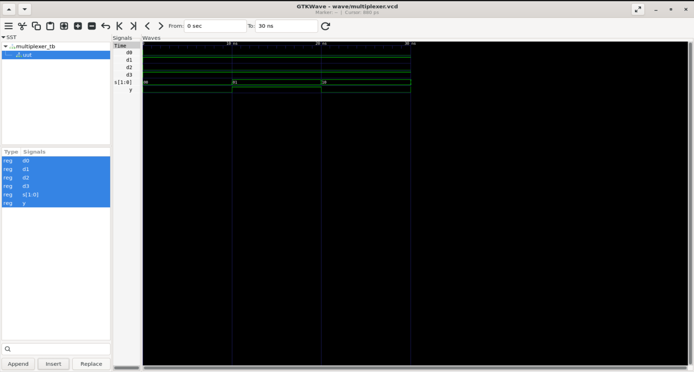
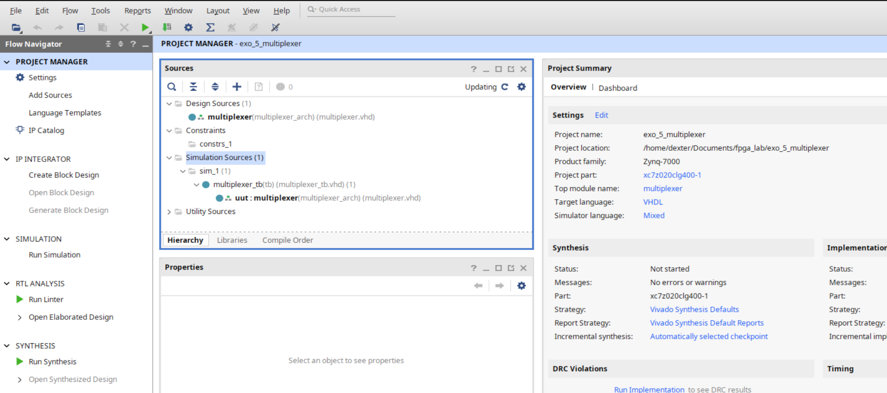
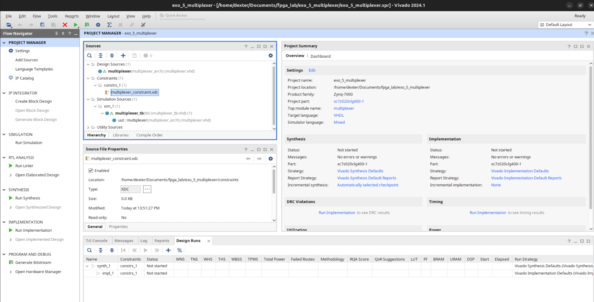
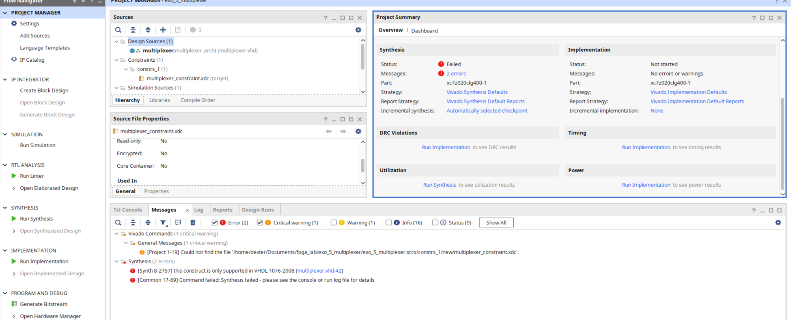
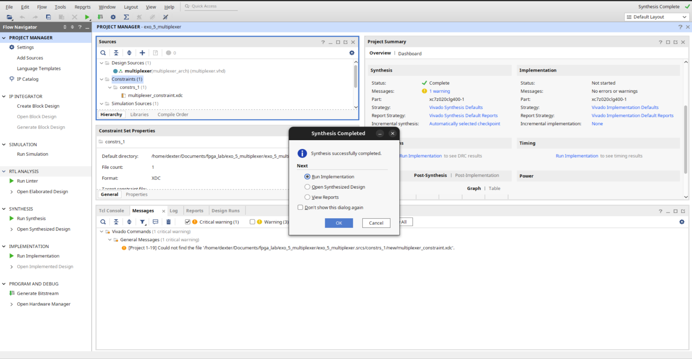
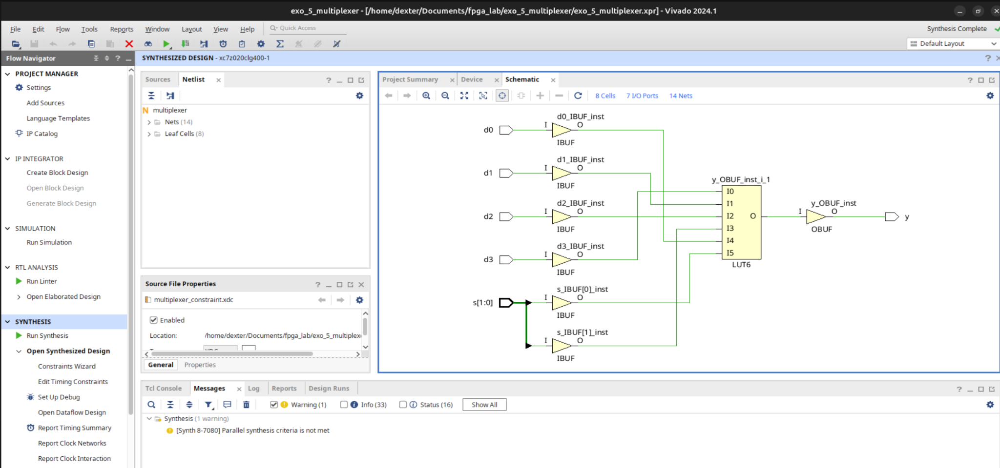
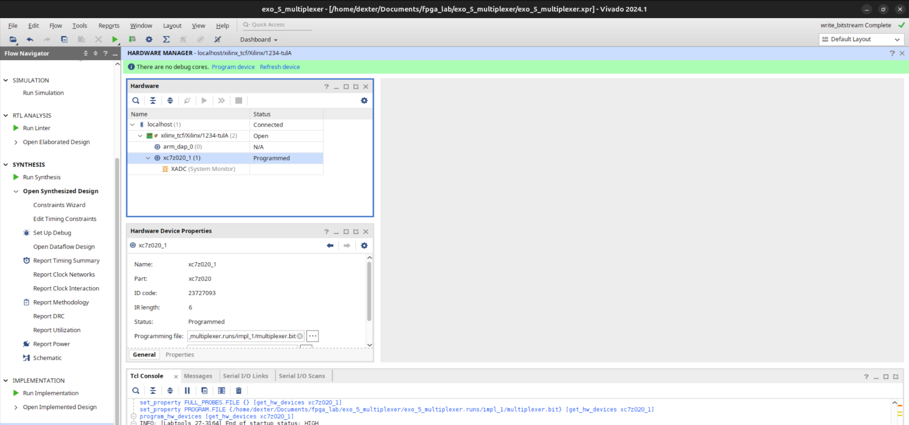

# FPGA Lab — Exercise 5: 4-to-1 Multiplexer

## 1. Objective

Implement and validate a **4-to-1 digital multiplexer (MUX)** on the PYNQ-Z2.

```text
D0 ─────┐
D1 ─────┤
D2 ─────┤─── [ MUX 4→1 ] ───> Y
D3 ─────┘
          ▲
        S1 S0
```

Selection table:

| S1 | S0 | Selected input | Output |
|---:|---:|---|---|
| 0 | 0 | D0 | Y = D0 |
| 0 | 1 | D1 | Y = D1 |
| 1 | 0 | D2 | Y = D2 |
| 1 | 1 | D3 | Y = D3 |

---

## 2. Main concept

A multiplexer is a digital selector: several inputs are available, but only one is routed to the output according to the selection bits.

Unlike the previous counter exercises, this circuit is **combinational**:

```text
inputs / selector change
          ↓
output changes
```

No clock, register, counter, or `rising_edge()` is required.

---

## 3. Switches as digital signals

SW0 and SW1 are physical switches, but inside the FPGA they appear as binary logic signals (`0` or `1`). They can therefore be used directly as selector bits.

```vhdl
s : in STD_LOGIC_VECTOR(1 downto 0);
```

For this exercise:

```text
s(0) ↔ SW0
s(1) ↔ SW1
```

---

## 4. VHDL design

```vhdl
library IEEE;
use IEEE.STD_LOGIC_1164.ALL;

entity multiplexer is
    port (
        d0 : in  STD_LOGIC;
        d1 : in  STD_LOGIC;
        d2 : in  STD_LOGIC;
        d3 : in  STD_LOGIC;
        s  : in  STD_LOGIC_VECTOR(1 downto 0);
        y  : out STD_LOGIC
    );
end multiplexer;

architecture multiplexer_arch of multiplexer is
begin
    process(d0, d1, d2, d3, s)
    begin
        if s = "00" then
            y <= d0;
        elsif s = "01" then
            y <= d1;
        elsif s = "10" then
            y <= d2;
        elsif s = "11" then
            y <= d3;
        else
            y <= '0';
        end if;
    end process;
end multiplexer_arch;
```

The final `else` ensures that `y` is assigned in every case and avoids unintended latch behavior for non-binary `STD_LOGIC` states such as `X`, `U`, or `Z`.

Alternative styles that also fit a MUX well are `case` and `with ... select`.

---

## 5. Clean repository layout

The project was migrated from Vivado-managed source locations to a cleaner repository structure:

```text
exo_5_multiplexer/
├── src/
│   └── multiplexer.vhd
├── sim/
│   └── multiplexer_tb.vhd
├── constraints/
│   └── multiplexer_constraint.xdc
├── wave/
│   └── multiplexer.vcd
├── Makefile
└── exo_5_multiplexer.xpr
```

Vivado still keeps generated folders (`.cache`, `.hw`, `.srcs`, etc.), but the real project sources now live in `src/`, `sim/`, and `constraints/`.

This is easier to manage with Git, VS Code, GHDL, GTKWave, vhdl-ls, and Vivado together.

---

## 6. vhdl-ls configuration

The root configuration supports both the clean layout and older Vivado-managed exercises:

```toml
standard = "2008"

[libraries]

fpga_lab.files = [
    "exo_*/src/**/*.vhd",
    "exo_*/sim/**/*.vhd",
    "exo_*/**/sources_1/**/*.vhd",
]
```

---

## 7. Testbench and parameterized test idea

A small procedure was used to avoid repeating the same `wait + assert` sequence for each selector value.

```vhdl
procedure test_mux(
    constant sel      : in STD_LOGIC_VECTOR(1 downto 0);
    constant expected : in STD_LOGIC
) is
begin
    s <= sel;
    wait for 10 ns;

    assert y = expected
        report "MUX test failed"
        severity error;
end procedure;
```

Then the test cases become:

```vhdl
test_mux("00", '0');
test_mux("01", '1');
test_mux("10", '0');
test_mux("11", '1');
```

This is conceptually similar to parameterized unit tests in software frameworks.

The full testbench used:

```vhdl
library IEEE;
use IEEE.STD_LOGIC_1164.ALL;

library std;
use std.env.all;

entity multiplexer_tb is
end multiplexer_tb;

architecture tb of multiplexer_tb is
    signal d0 : STD_LOGIC := '0';
    signal d1 : STD_LOGIC := '0';
    signal d2 : STD_LOGIC := '0';
    signal d3 : STD_LOGIC := '0';
    signal s  : STD_LOGIC_VECTOR(1 downto 0) := "00";
    signal y  : STD_LOGIC;
begin
    uut: entity work.multiplexer
        port map (
            d0 => d0,
            d1 => d1,
            d2 => d2,
            d3 => d3,
            s  => s,
            y  => y
        );

    stimulus: process
        procedure test_mux(
            constant sel      : in STD_LOGIC_VECTOR(1 downto 0);
            constant expected : in STD_LOGIC
        ) is
        begin
            s <= sel;
            wait for 10 ns;
            assert y = expected
                report "MUX test failed"
                severity error;
        end procedure;
    begin
        d0 <= '0';
        d1 <= '1';
        d2 <= '0';
        d3 <= '1';

        test_mux("00", '0');
        test_mux("01", '1');
        test_mux("10", '0');
        test_mux("11", '1');

        report "All multiplexer tests passed" severity note;
        finish;
    end process;
end tb;
```

---

## 8. GHDL simulation

Commands:

```bash
make sim
make wave
```

Successful result:

```text
All multiplexer tests passed
simulation finished @40ns
```

Expected behavior:

```text
s = 00 → y = d0
s = 01 → y = d1
s = 10 → y = d2
s = 11 → y = d3
```

---

## 9. GTKWave validation

The simulation used:

```text
d0 = 0
d1 = 1
d2 = 0
d3 = 1
```

Therefore:

```text
s : 00 ---- 01 ---- 10 ---- 11
y :  0 ----- 1 ----- 0 ----- 1
```



GTKWave showed the last VCD event at 30 ns even though the testbench finished at 40 ns. This is normal because the final signals stopped changing at 30 ns; the last 10 ns were only used to wait and assert the final state.

---

## 10. Vivado source setup

The clean files were referenced back into Vivado as:

```text
Design Source     → src/multiplexer.vhd
Simulation Source → sim/multiplexer_tb.vhd
Constraint        → constraints/multiplexer_constraint.xdc
```



---

## 11. XDC constraints

Hardware mapping used:

```text
D0 → BTN0
D1 → BTN1
D2 → BTN2
D3 → BTN3

S0 → SW0
S1 → SW1

Y  → LED0
```

ASCII view:

```text
BTN0 ─────┐
BTN1 ─────┤
BTN2 ─────┤── [ MUX 4→1 ] ───> LED0
BTN3 ─────┘
             ▲
           SW1 SW0
```

XDC:

```xdc
set_property PACKAGE_PIN D19 [get_ports d0]
set_property IOSTANDARD LVCMOS33 [get_ports d0]

set_property PACKAGE_PIN D20 [get_ports d1]
set_property IOSTANDARD LVCMOS33 [get_ports d1]

set_property PACKAGE_PIN L20 [get_ports d2]
set_property IOSTANDARD LVCMOS33 [get_ports d2]

set_property PACKAGE_PIN L19 [get_ports d3]
set_property IOSTANDARD LVCMOS33 [get_ports d3]

set_property PACKAGE_PIN M20 [get_ports {s[0]}]
set_property IOSTANDARD LVCMOS33 [get_ports {s[0]}]

set_property PACKAGE_PIN M19 [get_ports {s[1]}]
set_property IOSTANDARD LVCMOS33 [get_ports {s[1]}]

set_property PACKAGE_PIN R14 [get_ports y]
set_property IOSTANDARD LVCMOS33 [get_ports y]
```

No clock constraint is required because the circuit is purely combinational.



---

## 12. Issue: `process(all)` and VHDL-2008

The original implementation used:

```vhdl
process(all)
```

GHDL accepted it because the Makefile used `--std=08`, but Vivado initially reported:

```text
[Synth 8-2757] this construct is only supported in VHDL 1076-2008
```



The practical fix for this exercise was to replace it with an explicit sensitivity list:

```vhdl
process(d0, d1, d2, d3, s)
```

This also reinforced a key rule for combinational processes: every signal read by the process must be present in the sensitivity list when using this style.

---

## 13. Issue: stale Vivado constraint path

After moving the XDC file into `constraints/`, Vivado still referenced the old path:

```text
exo_5_multiplexer.srcs/constrs_1/new/multiplexer_constraint.xdc
```

The correct file was now:

```text
constraints/multiplexer_constraint.xdc
```

The solution was to keep the logical Vivado constraint set `constrs_1` and add the real XDC file back into that set by reference.

Important distinction:

```text
constrs_1 = Vivado constraint set
multiplexer_constraint.xdc = physical constraint file
```

---

## 14. Successful synthesis

After correcting the VHDL and constraint reference, synthesis completed successfully.



---

## 15. Synthesized hardware: one LUT6

Vivado implemented the complete MUX using a single **LUT6**.

The six logical inputs are:

```text
d0
d1
d2
d3
s0
s1
```

Simplified synthesized circuit:

```text
d0 ── IBUF ──┐
d1 ── IBUF ──┤
d2 ── IBUF ──┤
d3 ── IBUF ──┤
              ├── LUT6 ── OBUF ── y
s0 ── IBUF ──┤
s1 ── IBUF ──┘
```



This is an important FPGA lesson:

```text
VHDL if/elsif
      ↓
Boolean logic
      ↓
FPGA LUT
```

The source-code conditional is not a software instruction. Synthesis transforms it into physical combinational logic.

Expected resource behavior:

```text
0 flip-flops
0 registers
0 clock buffers
1 LUT6
```

---

## 16. Implementation, bitstream, and programming

Flow:

```text
Run Synthesis
   ↓
Run Implementation
   ↓
Generate Bitstream
   ↓
Open Hardware Manager
   ↓
Program Device
```

The PYNQ-Z2 was successfully programmed.



---

## 17. Hardware validation

Test matrix:

| SW1 | SW0 | Selected input | Expected result |
|---:|---:|---|---|
| 0 | 0 | BTN0 | LED0 follows BTN0 |
| 0 | 1 | BTN1 | LED0 follows BTN1 |
| 1 | 0 | BTN2 | LED0 follows BTN2 |
| 1 | 1 | BTN3 | LED0 follows BTN3 |

The physical test passed for all four selector combinations.

Additionally, for each selector value, the non-selected buttons had no effect.

Observed behavior:

```text
00 → only BTN0 controls LED0
01 → only BTN1 controls LED0
10 → only BTN2 controls LED0
11 → only BTN3 controls LED0
```

This validated the MUX end-to-end.

---

## 18. Concepts learned

```text
✓ what a multiplexer is
✓ many inputs → one output
✓ selector bits
✓ 2-bit selector for 4 inputs
✓ combinational logic
✓ no clock required
✓ no register required
✓ STD_LOGIC_VECTOR as selector bus
✓ if / elsif implementation
✓ case implementation
✓ with-select implementation
✓ complete assignment to avoid latches
✓ reusable VHDL test procedures
✓ GHDL simulation
✓ assertions
✓ GTKWave validation
✓ clean repository organization
✓ vhdl-ls source discovery
✓ Vivado source references
✓ XDC constraints
✓ Vivado constraint sets vs physical XDC files
✓ VHDL-2008 compatibility issue with process(all)
✓ synthesis
✓ synthesized schematic inspection
✓ LUT-based FPGA implementation
✓ LUT6 realization of a 4→1 MUX
✓ bitstream generation
✓ PYNQ-Z2 programming
✓ physical hardware validation
```

---

## 19. Abstraction levels

The same design can be understood at four levels.

### Logical concept

```text
four inputs
    ↓
selector
    ↓
one output
```

### VHDL

```text
00 → d0
01 → d1
10 → d2
11 → d3
```

### Synthesized FPGA structure

```text
6 logical inputs
      ↓
     LUT6
      ↓
      y
```

### Physical PYNQ-Z2 behavior

```text
SW1 SW0
   ↓
select one button
   ↓
LED0 follows only that button
```

The main lesson is:

> VHDL describes hardware behavior, and synthesis transforms that description into real FPGA resources.

---

## 20. Possible future extension

A more advanced version could use four digitally generated waveforms:

```text
D0 → sine-like sampled waveform
D1 → square wave
D2 → triangle wave
D3 → sawtooth wave
```

Then SW1/SW0 would choose which waveform is routed to the output.

A Flutter interface could later visualize the selected channel and animated data flow.

---

## 21. Exercise progression

```text
Exercise 0 : switch → LED
   ↓
Exercise 1 : logic gate / LUT
   ↓
Exercise 2 : clocked logic
   ↓
Exercise 3 : 4-bit binary counter
   ↓
Exercise 4 : modulo-10 counter + reset
   ↓
Exercise 5 : 4-to-1 multiplexer
   ↓
Exercise 6 : demultiplexer
```

Exercise 5 reinforced combinational logic and showed how a high-level VHDL selection structure becomes a real LUT inside the FPGA.
