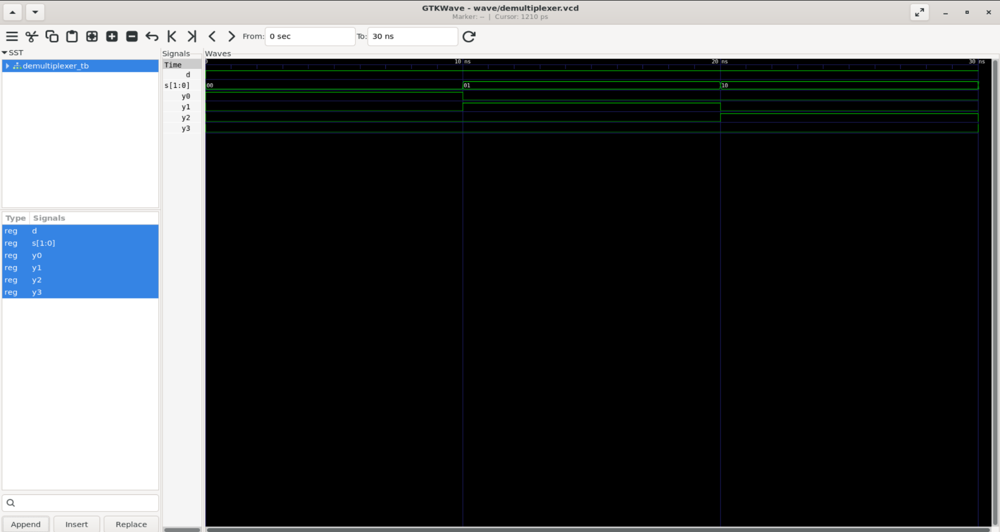
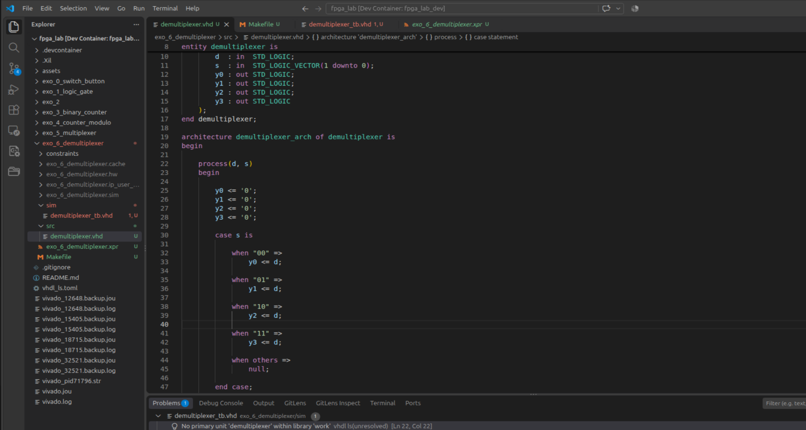
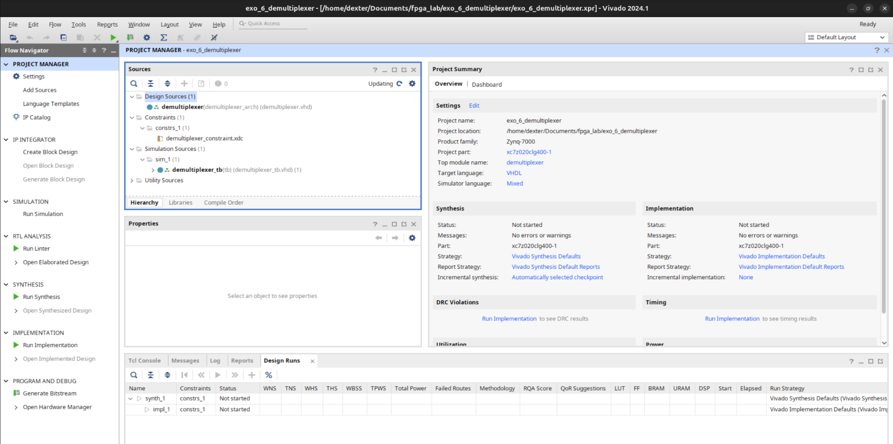
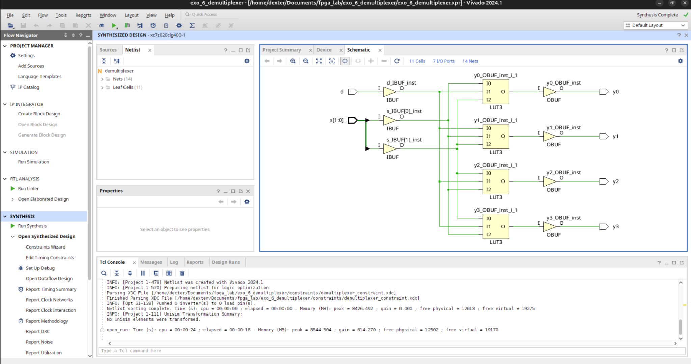

# FPGA Lab — Exercise 6: 1-to-4 Demultiplexer

## 1. Objective

The goal of Exercise 6 was to implement and validate a **1-to-4 digital demultiplexer (DEMUX)** on the PYNQ-Z2.

A demultiplexer performs the opposite operation of a multiplexer:

```text
MUX   : many inputs → one output
DEMUX : one input → many outputs
```

For this exercise:

```text
D      : data input
S1, S0 : selection inputs
Y0..Y3 : outputs
```

Functional view:

```text
                 ┌──> Y0
                 ├──> Y1
D ── [ DEMUX ] ──┤
                 ├──> Y2
                 └──> Y3
                    ▲
                  S1 S0
```

The selection table is:

| S1 | S0 | Active output |
|---:|---:|---|
| 0 | 0 | Y0 = D |
| 0 | 1 | Y1 = D |
| 1 | 0 | Y2 = D |
| 1 | 1 | Y3 = D |

All non-selected outputs remain at `0`.

---

## 2. Relationship with Exercise 5

Exercise 5 implemented a 4-to-1 MUX:

```text
D0 D1 D2 D3
      ↓
    MUX
      ↓
      Y
```

Exercise 6 implements the reverse routing structure:

```text
      D
      ↓
    DEMUX
      ↓
Y0 Y1 Y2 Y3
```

Together:

```text
MUX   → choose one input
DEMUX → choose one output
```

---

## 3. Repository structure

The clean repository layout introduced in Exercise 5 was reused:

```text
exo_6_demultiplexer/
├── src/
│   └── demultiplexer.vhd
├── sim/
│   └── demultiplexer_tb.vhd
├── constraints/
│   └── demultiplexer_constraint.xdc
├── wave/
│   └── demultiplexer.vcd
├── Makefile
└── exo_6_demultiplexer.xpr
```

Vivado still maintains generated folders for project management, but the real source files used by Git, VS Code, GHDL, GTKWave, vhdl-ls, and Vivado live in `src/`, `sim/`, and `constraints/`.

---

## 4. VHDL entity

```vhdl
library IEEE;
use IEEE.STD_LOGIC_1164.ALL;

entity demultiplexer is
    port (
        d  : in  STD_LOGIC;
        s  : in  STD_LOGIC_VECTOR(1 downto 0);
        y0 : out STD_LOGIC;
        y1 : out STD_LOGIC;
        y2 : out STD_LOGIC;
        y3 : out STD_LOGIC
    );
end demultiplexer;
```

The selector `s` is a 2-bit bus:

```text
s(0) = S0
s(1) = S1
```

Two bits are enough to select one of four outputs.

---

## 5. First implementation issue

The first attempt included:

```vhdl
when others =>
    s <= 0;
```

This caused two errors:

```text
interface signal 's' of mode in may not be the target of an assignment
```

and:

```text
integer literal does not match subtype 'STD_LOGIC_VECTOR'
```

The reasons were:

1. `s` is declared as an input, so it can be read but not assigned.
2. `0` is an integer literal, while `s` is a `STD_LOGIC_VECTOR`.

Even `"00"` would still be invalid because `s` is an input.

---

## 6. Important DEMUX rule: assign all outputs

A first version only assigned the selected output, for example:

```vhdl
when "00" =>
    y0 <= d;
```

But the other outputs also need defined values in combinational logic.

The clean solution is to reset all outputs first:

```vhdl
y0 <= '0';
y1 <= '0';
y2 <= '0';
y3 <= '0';
```

and then route `d` only to the selected output.

---

## 7. Final DEMUX architecture

```vhdl
architecture demultiplexer_arch of demultiplexer is
begin

    process(d, s)
    begin

        y0 <= '0';
        y1 <= '0';
        y2 <= '0';
        y3 <= '0';

        case s is

            when "00" =>
                y0 <= d;

            when "01" =>
                y1 <= d;

            when "10" =>
                y2 <= d;

            when "11" =>
                y3 <= d;

            when others =>
                null;

        end case;

    end process;

end demultiplexer_arch;
```

The process sensitivity list contains only the input signals read by the process:

```text
d
s
```

---

## 8. Functional behavior

For `d = 1`:

```text
s = 00 → y0=1 y1=0 y2=0 y3=0
s = 01 → y0=0 y1=1 y2=0 y3=0
s = 10 → y0=0 y1=0 y2=1 y3=0
s = 11 → y0=0 y1=0 y2=0 y3=1
```

For `d = 0`, all outputs remain zero.

ASCII view:

```text
                 S1 S0
                   │
                   ▼
D ───────────────> DEMUX
                   │
         ┌─────────┼─────────┬─────────┐
         ▼         ▼         ▼         ▼
        Y0        Y1        Y2        Y3
```

Only one path is enabled at a time.

---

## 9. Makefile

```make
TOP = demultiplexer_tb
VCD = wave/demultiplexer.vcd

SRC = src/demultiplexer.vhd
TB  = sim/demultiplexer_tb.vhd

analyze:
	ghdl -a --std=08 $(SRC)
	ghdl -a --std=08 $(TB)

elaborate: analyze
	ghdl -e --std=08 $(TOP)

sim: elaborate
	mkdir -p wave
	ghdl -r --std=08 $(TOP) --vcd=$(VCD)

wave: sim
	gtkwave $(VCD)

clean:
	rm -f *.cf
	rm -f wave/*.vcd
```

Useful commands:

```bash
make sim
make wave
```

---

## 10. Testbench

The testbench uses a small helper procedure:

```vhdl
procedure test_demux(
    constant sel : in STD_LOGIC_VECTOR(1 downto 0);
    constant e0  : in STD_LOGIC;
    constant e1  : in STD_LOGIC;
    constant e2  : in STD_LOGIC;
    constant e3  : in STD_LOGIC
) is
begin

    s <= sel;

    wait for 10 ns;

    assert y0 = e0
        report "DEMUX test failed on y0"
        severity error;

    assert y1 = e1
        report "DEMUX test failed on y1"
        severity error;

    assert y2 = e2
        report "DEMUX test failed on y2"
        severity error;

    assert y3 = e3
        report "DEMUX test failed on y3"
        severity error;

end procedure;
```

With `d = '1'`, the test cases are:

```vhdl
test_demux("00", '1', '0', '0', '0');
test_demux("01", '0', '1', '0', '0');
test_demux("10", '0', '0', '1', '0');
test_demux("11", '0', '0', '0', '1');
```

These calls closely mirror the DEMUX truth table.

---

## 11. GHDL simulation

The simulation completed successfully:

```text
All demultiplexer tests passed
simulation finished @40ns
```

Flow:

```text
VHDL
→ GHDL analysis
→ elaboration
→ simulation
→ assertions
→ VCD
```

---

## 12. GTKWave validation

Screenshot:



The selector moved through:

```text
00 → 01 → 10 → 11
```

and the active output moved accordingly:

```text
time    0ns      10ns     20ns     30ns
        |---------|---------|---------|

s       00        01        10        11

y0      1         0         0         0
y1      0         1         0         0
y2      0         0         1         0
y3      0         0         0         1
```

---

## 13. vhdl-ls warning vs actual compiler result

VS Code / vhdl-ls temporarily reported:

```text
No primary unit 'demultiplexer' within library 'work'
```

However, GHDL successfully analyzed, elaborated, and simulated the design.

This showed that the design itself was correct and the warning was related to language-server indexing.

Screenshot:



---

## 14. PYNQ-Z2 constraints

Hardware mapping:

```text
D      → BTN0
S0     → SW0
S1     → SW1

Y0     → LED0
Y1     → LED1
Y2     → LED2
Y3     → LED3
```

ASCII view:

```text
BTN0 ────────────────> D

SW1 SW0
   │
   ▼
[ DEMUX 1→4 ]
   │
   ├──> LED0
   ├──> LED1
   ├──> LED2
   └──> LED3
```

XDC:

```xdc
## Input data - BTN0

set_property PACKAGE_PIN D19 [get_ports d]
set_property IOSTANDARD LVCMOS33 [get_ports d]


## Selection - SW0 / SW1

set_property PACKAGE_PIN M20 [get_ports {s[0]}]
set_property IOSTANDARD LVCMOS33 [get_ports {s[0]}]

set_property PACKAGE_PIN M19 [get_ports {s[1]}]
set_property IOSTANDARD LVCMOS33 [get_ports {s[1]}]


## Outputs - LED0..LED3

set_property PACKAGE_PIN R14 [get_ports y0]
set_property IOSTANDARD LVCMOS33 [get_ports y0]

set_property PACKAGE_PIN P14 [get_ports y1]
set_property IOSTANDARD LVCMOS33 [get_ports y1]

set_property PACKAGE_PIN N16 [get_ports y2]
set_property IOSTANDARD LVCMOS33 [get_ports y2]

set_property PACKAGE_PIN M14 [get_ports y3]
set_property IOSTANDARD LVCMOS33 [get_ports y3]
```

No clock constraint is required because the DEMUX is purely combinational.

---

## 15. Vivado project setup

The project correctly referenced:

```text
Design Source:
src/demultiplexer.vhd

Simulation Source:
sim/demultiplexer_tb.vhd

Constraint:
constraints/demultiplexer_constraint.xdc
```

Screenshot:



Target device:

```text
xc7z020clg400-1
```

Top module:

```text
demultiplexer
```

---

## 16. Synthesized hardware

Vivado implemented the DEMUX using:

```text
4 × LUT3
```

one LUT for each output.

Screenshot:



Each output depends on:

```text
d
s0
s1
```

So the Boolean equations are:

```text
y0 = d AND NOT s1 AND NOT s0
y1 = d AND NOT s1 AND     s0
y2 = d AND     s1 AND NOT s0
y3 = d AND     s1 AND     s0
```

Simplified synthesized structure:

```text
                ┌── LUT3 ──> y0
d ──────────────┼── LUT3 ──> y1
                ├── LUT3 ──> y2
s0 ─────────────┤
s1 ─────────────└── LUT3 ──> y3
```

---

## 17. Comparison with the MUX

Exercise 5:

```text
MUX 4→1
6 logical inputs
→ 1 LUT6
```

Exercise 6:

```text
DEMUX 1→4
3 logical inputs per output
→ 4 LUT3
```

The DEMUX has four independent output functions, so Vivado synthesizes one LUT3 per output.

---

## 18. Pure combinational logic

The synthesized design confirms:

```text
0 clocks
0 flip-flops
0 registers
4 LUT3
```

There is no state or memory.

The outputs react directly to the current values of `d` and `s`.

---

## 19. Hardware validation

After synthesis, implementation, bitstream generation, and programming, the hardware test was:

| SW1 | SW0 | Expected behavior |
|---:|---:|---|
| 0 | 0 | LED0 follows BTN0 |
| 0 | 1 | LED1 follows BTN0 |
| 1 | 0 | LED2 follows BTN0 |
| 1 | 1 | LED3 follows BTN0 |

For every selector state:

```text
selected LED → follows BTN0
other LEDs   → remain off
```

All sequences behaved exactly as expected on the PYNQ-Z2.

---

## 20. Main concepts learned

```text
✓ what a demultiplexer is
✓ one input → many outputs
✓ 2-bit selector for 4 outputs
✓ combinational routing
✓ default output assignments
✓ avoiding incomplete combinational assignments
✓ input ports cannot be assigned by the architecture
✓ case statements
✓ when others => null
✓ sensitivity lists
✓ parameterized-style VHDL test procedures
✓ GHDL simulation
✓ assertions
✓ GTKWave validation
✓ vhdl-ls indexing vs compiler validation
✓ clean repository layout
✓ XDC constraints
✓ Vivado synthesis
✓ reading a synthesized schematic
✓ Boolean equations
✓ LUT3 implementation
✓ MUX vs DEMUX resource comparison
✓ FPGA programming
✓ physical hardware validation
```

---

## 21. From VHDL to FPGA hardware

The VHDL description:

```text
00 → route d to y0
01 → route d to y1
10 → route d to y2
11 → route d to y3
```

is synthesized into Boolean logic:

```text
VHDL case statement
        ↓
Boolean equations
        ↓
4 LUT3
        ↓
physical FPGA routing
```

This reinforces a central FPGA concept:

> VHDL describes hardware behavior, not a sequence of CPU instructions.

---

## 22. Exercise progression

```text
Exercise 0 : switch → LED
   ↓
Exercise 1 : logic gate / LUT
   ↓
Exercise 2 : clocked logic
   ↓
Exercise 3 : 4-bit binary counter
   ↓
Exercise 4 : modulo-10 counter + reset
   ↓
Exercise 5 : 4-to-1 multiplexer
   ↓
Exercise 6 : 1-to-4 demultiplexer
```

Exercises 5 and 6 together introduce two fundamental digital routing structures:

```text
MUX   = select one source
DEMUX = select one destination
```
