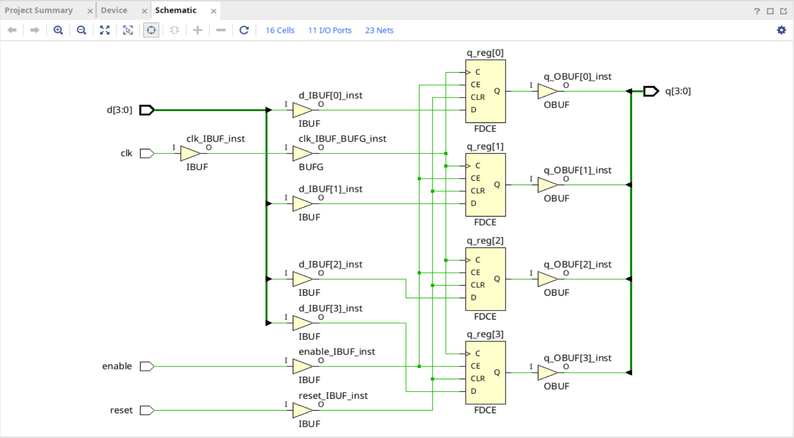
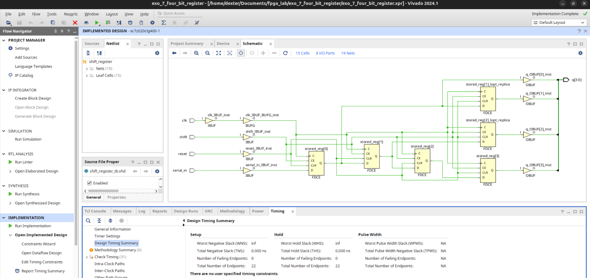
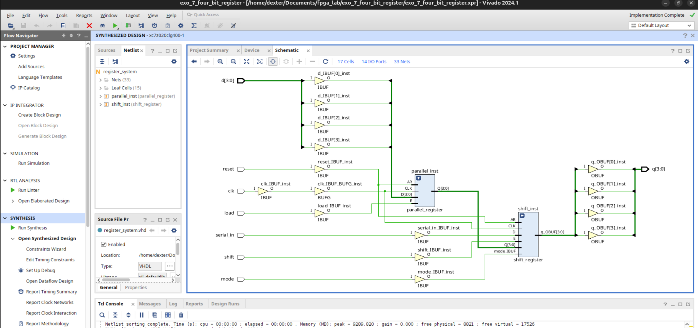
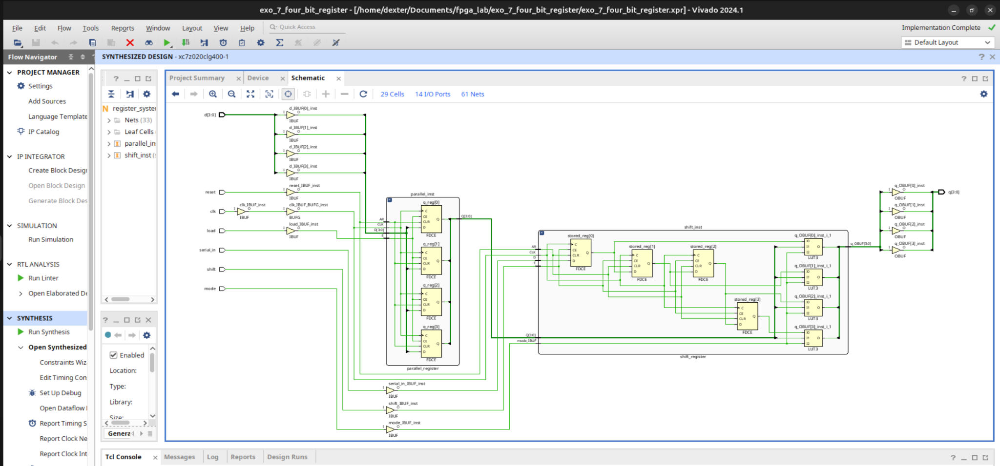
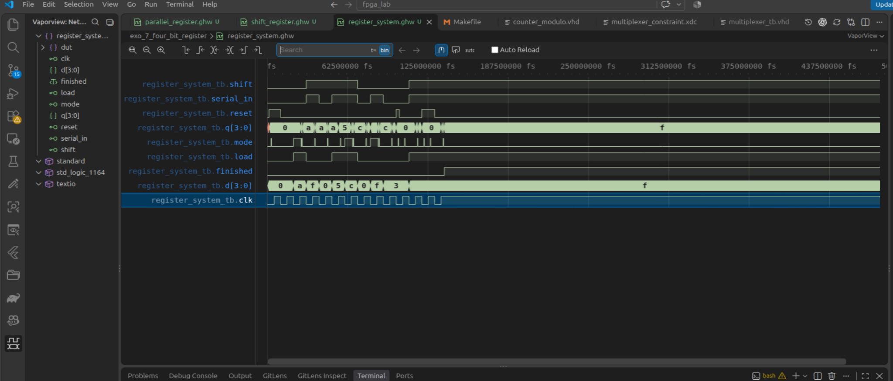
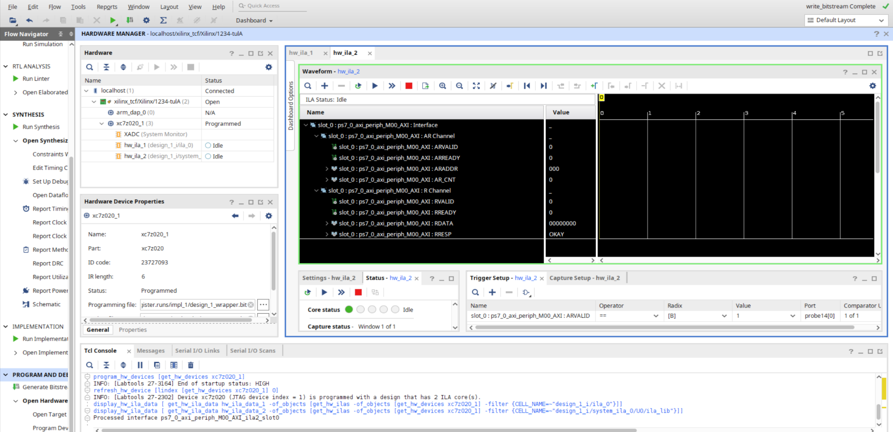
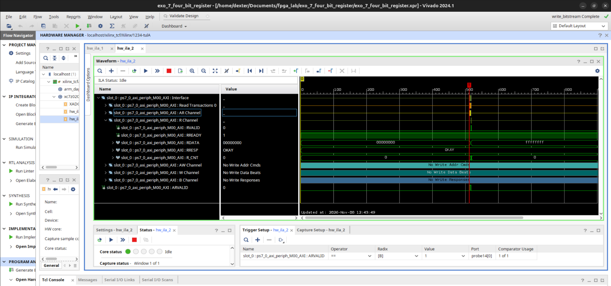
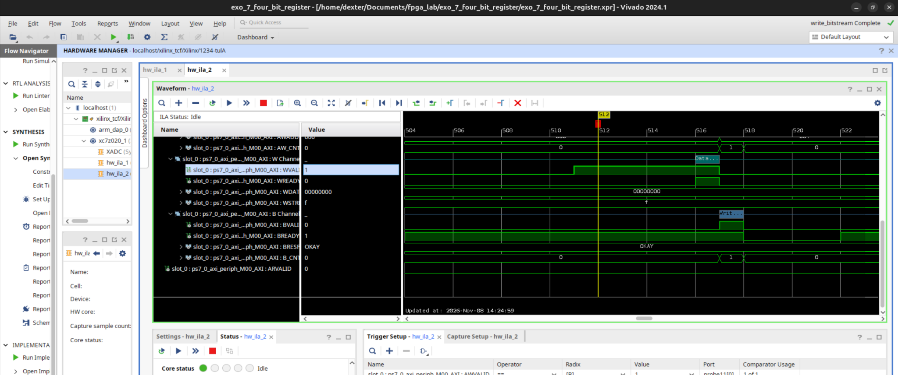

# Exercise 7 — Four-Bit Registers in VHDL

**FPGA Lab · Technical report and learning summary**  
**Target board:** PYNQ-Z2 (Zynq-7020, `xc7z020clg400-1`)  
**Toolchain:** GHDL (VHDL-2008 simulation), VaporView (VS Code waveform inspection), Vivado 2024.1 (synthesis, implementation and timing)   
**Validation scope:** RTL simulation, Vivado synthesis/timing analysis **and PYNQ-Z2 hardware validation** (50 MHz PS/PL design; details in Section 9)

## 1. Purpose and scope

The purpose of this exercise is to revisit **sequential digital logic** by implementing and examining two basic four-bit storage circuits:

1. A **parallel register** with a clock enable and asynchronous active-high reset.
2. A **serial-in, parallel-out (SIPO) shift register** with a shift enable and the same reset convention.

A third, lightweight `register_system` module composes both registers and multiplexes their outputs. The focus is on how VHDL describes clocked hardware, how a testbench proves specified behaviors, and what Vivado actually synthesizes.

The **core learning exercise** remains the VHDL register design, GHDL simulation, and standalone Vivado analysis described in Sections 3–7. A **separate PS–PL integration of the same RTL** was subsequently implemented and successfully tested on the PYNQ-Z2 on 8 November 2026. Section 9 documents this later validation without conflating its 50 MHz clock and AXI peripherals with the earlier, standalone 125 MHz timing experiment.

## 2. Project structure

The relevant, hand-maintained files are organized as follows; the Vivado-generated folders are omitted:

```text
exo_7_four_bit_register/
├── src/
│   ├── parallel_register.vhd
│   ├── shift_register.vhd
│   ├── register_system.vhd
│   └── register_command_adapter.vhd  # PS/PL integration helper
├── sim/
│   ├── parallel_register_tb.vhd
│   ├── shift_register_tb.vhd
│   └── register_system_tb.vhd
├── constraints/
│   └── parallel_register.xdc   # standalone historical constraint (see Section 6)
├── notebooks/
│   └── register_test.ipynb     # validated PS/PL notebook
├── scripts/
│   └── configure_debug_hub.tcl # Debug Hub timing configuration
├── assets/                    # original figures + three new hardware captures
└── exo_7_four_bit_register.xpr
```

> **Two distinct contexts:** `parallel_register.xdc` with `create_clock -period 8.000` belongs to the historical **standalone 125 MHz analysis** in Section 6. It was **disabled** for the validated Zynq `design_1` implementation, where the PS drives FCLK0 at **50 MHz**. Do not reactivate the standalone constraint in the PS/PL design. Renaming the original XDC would require updating the Vivado project reference.

## 3. Design fundamentals

### 3.1 Parallel register (4 bits)

```text
                  +-----------------------------+
        d[3:0] -->| D[3:0]               Q[3:0] |--> parallel_q[3:0]
          load -->| CE         4 × D flip-flops   |
           clk -->| CLK                         |
         reset -->| asynchronous clear          |
                  +-----------------------------+
```

The corresponding RTL is based on:

```vhdl
process (clk, reset)
begin
    if reset = '1' then
        q <= (others => '0');
    elsif rising_edge(clk) then
        if enable = '1' then
            q <= d;
        end if;
    end if;
end process;
```

- `reset = '1'`: clears the four stored bits **asynchronously**, independent of the clock.
- Rising edge and `enable = '1'`: captures all four inputs together.
- Rising edge and `enable = '0'`: retains the previously stored value.
- No assignment in the disabled clocked branch means flip-flop state retention, **not** a combinational latch.

Vivado mapped the parallel register to **four `FDCE` primitives**, which include clock (`C`), clock enable (`CE`), asynchronous clear (`CLR`), data (`D`) and output (`Q`). External `IBUF`/`OBUF` cells and a clock `BUFG` were also visible in the standalone implementation schematic.



*Figure 1 — Vivado schematic of the standalone parallel register. Source: screenshot supplied during the exercise.*

### 3.2 SIPO shift register (4 bits)

```text
 serial_in ---> [D FF0 Q] ---> [D FF1 Q] ---> [D FF2 Q] ---> [D FF3 Q]
                  |              |              |              |
                 q(0)           q(1)           q(2)           q(3)

      Common clock: clk       Shift enable: shift
      Common asynchronous active-high clear: reset
```

The key VHDL operation is:

```vhdl
if shift = '1' then
    stored <= stored(2 downto 0) & serial_in;
end if;
```

On each rising clock edge with `shift = '1'`, the incoming serial bit enters `stored(0)`, while each previous bit moves toward the most-significant position. The prior `stored(3)` bit is discarded. With `shift = '0'`, the complete word is retained. As in the parallel register, the asynchronous `reset` clears storage without waiting for a rising edge.

Example, starting from `0000`:

| Rising edge | `serial_in` | `q[3:0]` |
|---:|:---:|:---:|
| Reset | — | `0000` |
| 1 | 1 | `0001` |
| 2 | 0 | `0010` |
| 3 | 1 | `0101` |
| 4 | 1 | `1011` |



*Figure 2 — Standalone shift-register implementation. The physical optimization view contained cells with `_lopt_replica` suffixes; these should not be confused with additional architectural storage bits.*

### 3.3 Top-level register system

The `register_system.vhd` top-level instantiates the registers in parallel and uses `mode` **only** to select which stored word appears at the output:

```text
                           +-----------------------+
 d[3:0] ------------------>| parallel_register     |--- parallel_q[3:0] --+
 load -------------------->| enable                |                       |
                          +-----------------------+                       |
                                                                          +--[ 2:1 MUX ]--> q[3:0]
                          +-----------------------+                       |      ^
 serial_in -------------->| shift_register        |--- shift_q[3:0] -----+      |
 shift ------------------>| shift enable          |                            mode
                          +-----------------------+

 clk ---------------------> both register instances
 reset -------------------> both register instances
```

The selection is combinational:

```vhdl
q <= parallel_q when mode = '0' else shift_q;
```

Therefore changing `mode` can change `q` **between** clock edges; it does **not** enable, disable or reset either register. `load` and `shift` are independent, so both registers can update on the same rising edge even though only one is visible through `q` at any moment.

The Boolean function for each output bit is:

```text
q[i] = (NOT mode AND parallel_q[i]) OR (mode AND shift_q[i])
```

This illustrates how a sequential-storage exercise builds on the combinational multiplexers studied in Exercise 5.



*Figure 3 — Top-level system hierarchy and connectivity in Vivado.*



*Figure 4 — Expanded synthesized netlist: 4 parallel flip-flops, 4 shift flip-flops and combinational selection logic visible as four `LUT3` symbols.*

## 4. RTL functional verification

### 4.1 Testbench strategy

The `register_system_tb.vhd` testbench instantiates the **public top-level interface**, rather than probing internal storage signals. It uses:

- A 10 ns simulated clock (`CLK_PERIOD = 10 ns`). This is a **testbench stimulus period** and is independent of the 8 ns Vivado timing constraint.
- A `cycle(...)` helper: prepares inputs at a falling edge, waits for a rising edge, and checks the selected output.
- A `check_outputs(...)` helper: toggles `mode` and checks **both** register values through the same public `q[3:0]` port, including their retention.
- Self-checking VHDL `assert` statements with `severity failure` on mismatch.
- A 500 ns watchdog that fails if the testbench does not complete.

### 4.2 Six tested behaviors

| # | Testbench scenario | Verified intention |
|---:|---|---|
| 1 | Common asynchronous reset | Both registers clear before another rising edge is required |
| 2 | Independent commands | Each register may update while the other is selected at the output |
| 3 | Simultaneous `load` and `shift` | Both operations take place on one rising edge |
| 4 | Hold with changing inputs | Both stored words remain unchanged when both enables are low |
| 5 | Reset between rising edges | Both nonzero states are cleared asynchronously |
| 6 | Reset priority | An asserted reset overrides active operations; updates resume after reset release and a subsequent rising edge |

### 4.3 Executed GHDL commands and result

From the exercise directory in the development container:

```bash
ghdl -a --std=08 \
  src/parallel_register.vhd \
  src/shift_register.vhd \
  src/register_system.vhd \
  sim/register_system_tb.vhd

ghdl -e --std=08 register_system_tb

ghdl -r --std=08 register_system_tb \
  --wave=register_system.ghw \
  --stop-time=1us
```

The commands returned **exit code 0**, and the simulation reported:

```text
sim/register_system_tb.vhd:152:9:@137500ps:(report note): Tous les tests du systeme de registres ont reussi.
```

**Outcome:** All six testbench scenarios completed successfully by **137.5 ns**. This proves the specified simulated behaviors for the exercised cases; it is not a formal proof over all possible input traces.



*Figure 5 — Final `register_system.ghw` trace opened with VaporView in VS Code. The `finished` signal rises after the tested scenarios.*

The two individual registers were also simulated and inspected:

| Standalone module | Waveform |
|---|---|
| Parallel | [parallel_waveform.png](assets/parallel_waveform.png) |
| SIPO shift | [shift_waveform.png](assets/shift_waveform.png) |

## 5. Vivado synthesis and resource mapping

**Target:** Zynq-7020 `xc7z020clg400-1`  
**Vivado:** 2024.1  
**Top:** `register_system`

The supplied **hierarchical synthesis utilization report** states:

| Hierarchy | Logic LUTs | Flip-flops | BRAMs | DSPs |
|---|---:|---:|---:|---:|
| `parallel_inst` | 0 | 4 | 0 | 0 |
| `shift_inst` | 2 | 4 | 0 | 0 |
| **Total `register_system`** | **2** | **8** | **0** | **0** |

This confirms the intended eight bits of sequential storage. The expanded schematic shows four `FDCE` instances per register and **four `LUT3`-labeled selection functions**, whereas the hierarchy utilization report shows **two LUTs** in total. The screenshots and resource report are different views of the synthesis result; the supplied evidence alone does not establish exactly how those four schematic functions are accounted for in two physical LUT resources. A cell-level utilization report and primitive properties would be needed to resolve that distinction rigorously. **Do not report four physical LUTs from the schematic alone.**

## 6. Standalone RTL timing constraints and analysis

The exercise's XDC defined the input clock:

```tcl
create_clock -name sys_clk -period 8.000 [get_ports clk]
```

This declares a nominal **125 MHz** timing clock (8 ns period). It specifies a timing requirement; by itself, it **does not** assign the signal to a PYNQ-Z2 package pin or guarantee a running 125 MHz source on real hardware.

### 6.1 Synthesized vs fully routed results

| Metric | Synthesized design | Fully routed design |
|---|---:|---:|
| Setup WNS | +6.777 ns | **+6.746 ns** |
| Hold WHS | +0.156 ns | **+0.294 ns** |
| Pulse-width WPWS | +3.500 ns | **+3.500 ns** |
| Total negative slack (TNS) | 0.000 ns | **0.000 ns** |
| Failing endpoints | 0 | **0** |

The final timing report was generated for **`register_system`, Design State: Routed**, and states: **“All user specified timing constraints are met.”** These results cover the paths constrained by the current XDC; they are not a complete board-level interface timing signoff.

### 6.2 Critical path after routing

The worst setup path connects two SIPO stages:

```text
shift_inst/stored_reg[2]/Q
            |
            |   C-to-Q propagation: 0.518 ns
            |   routed net:         0.672 ns
            v
shift_inst/stored_reg[3]/D

Total data path delay = 1.190 ns
Setup slack           = +6.746 ns
```

Both endpoints were placed in `SLICE_X0Y13` in the fully routed report. The worst hold path was from `stored_reg[0]` to `stored_reg[1]`, with **+0.294 ns** hold slack. This is a useful illustration of **setup** (data arrives early enough before the receiving clock edge) versus **hold** (data remains stable long enough around the receiving edge).

### 6.3 Remaining methodology warnings

The fully routed `report_methodology` found **12 `TIMING-18` warnings** about missing external input/output delays:

- 8 inputs: `d[3:0]`, `load`, `reset`, `serial_in`, `shift`.
- 4 outputs: `q[3:0]`.

`clk` is covered by `create_clock`; `mode` is not enumerated in the report's 12 warnings. Its presence and timing relevance must still be assessed when defining any real external interface, rather than assuming the warning list is an exhaustive interface specification.

These warnings are expected for an exercise where the external timing contract has **not yet been defined**. Do not invent `set_input_delay`/`set_output_delay` values merely to silence them. Such constraints require a real source/destination and timing specification. Similarly, the asynchronous reset's release requires appropriate synchronization or other justified timing treatment in a physical design.

The provided run also did not include a full PYNQ-Z2 pin mapping and electrical I/O standards. This is **not** a board-ready bitstream verification.

## 7. Interpretation and lessons learned

1. **Registers are parallel hardware.** Four `FDCE` cells store four bits simultaneously on a shared clock edge; they are not a sequence of software statements.
2. **An enable does not gate the clock in this RTL.** The `FDCE` primitive has a dedicated `CE` input.
3. **An asynchronous reset can change state between clock edges.** Its deassertion on hardware needs additional care.
4. **A SIPO register is a chain of state elements.** The output of one stage supplies the next stage's D input.
5. **A parent entity composes modules, not necessarily a controller.** `register_system` has no FSM or bus protocol.
6. **`mode` controls observation, not operation.** Both registers remain independently active and retain distinct states.
7. **A clean RTL simulation is not a hardware test.** GHDL validates the tested logic, while Vivado reports mapping and timing of the constrained design.
8. **Synthesis and routed results must not be conflated.** Placement and routing change delay estimates and may change netlist structure.


## 8. Verification status and conclusion

The standalone RTL verification was completed on **6 November 2026**; the **PS/PL hardware validation** followed on **8 November 2026**. They use different clock/timing configurations and must not be conflated.

| Verification stage | Status | Evidence / qualification |
|---|---|---|
| Standalone VHDL RTL | Completed | `parallel_register.vhd`, `shift_register.vhd` |
| Standalone waveforms | Inspected | Original VaporView screenshots in `assets/` |
| Composed system RTL test | **PASS** | Six GHDL scenarios, completion at 137.5 ns |
| Standalone Vivado synthesis | Completed | 8 flip-flops; 2 LUTs in hierarchical utilization |
| Standalone routed timing at 125 MHz | Met | Setup WNS +6.746 ns; WHS +0.294 ns; TNS 0 |
| Standalone external I/O timing | Incomplete | 12 TIMING-18 warnings; no physical board I/O timing contract |
| PS/PL Zynq integration | **PASS** | `design_1`, AXI GPIO, command adapter and FPGA register system |
| AXI GPIO read and write | **PASS for captured transactions** | Read returned data; write produced `BRESP=OKAY` |
| Parallel register on PYNQ-Z2 | **PASS** | Expected `0xA`, actual `0xA` |
| SIPO shift register on PYNQ-Z2 | **PASS** | Sequence `1,0,1,1`, final output `0xB` |
| Output multiplexer on PYNQ-Z2 | **PASS** | `mode=0` -> `0xA`; `mode=1` -> `0xB` |
| Software-driven reset | Not available | Adapter `reset_out` is not connected to `register_system.reset` |
| Original intermittent MMIO hangs | Root cause **unconfirmed** | Operational success demonstrated, but no controlled A/B isolation |

**Conclusion:** Exercise 7 now has both **successful standalone RTL simulation/timing analysis** and **successful physical-board register tests**. This does **not** establish that the previously observed intermittent MMIO hangs were permanently fixed or conclusively root-caused.

## 9. PYNQ-Z2 PS/PL integration and hardware validation

### 9.1 Validated hardware configuration

| Item | Validated `design_1` configuration |
|---|---|
| Board / silicon | PYNQ-Z2 / XC7Z020 (`xc7z020clg400-1`) |
| Tool | Vivado 2024.1; PYNQ Linux + Python notebook |
| PS AXI master | `processing_system7_0/M_AXI_GP0` |
| AXI slave | `axi_gpio_0/S_AXI`, mapped at `0x41200000`, 4 KiB MMIO mapping |
| Channel 1 | 9 output command bits (`C_GPIO_WIDTH=9`, `C_ALL_OUTPUTS=1`) |
| Channel 2 | 4 input bits (`C_GPIO2_WIDTH=4`, `C_ALL_INPUTS_2=1`) |
| Clock | `processing_system7_0/FCLK_CLK0`, **50 MHz runtime target** |
| Clock/reset | `rst_ps7_0_50M`, `dcm_locked` tied to logic 1, PS reset connected |
| ILA | `ila_0` for reset observations; `system_ila_0` on `ps7_0_axi_periph/M00_AXI` |
| Notebook | [`notebooks/register_test.ipynb`](notebooks/register_test.ipynb) |

**This is not the standalone 125 MHz implementation discussed in Section 6.** If following a separate 100 MHz script-generated overlay described elsewhere in the repository, do not substitute this notebook's 50 MHz configuration without first confirming that overlay's actual clock design and address map.

```text
                             Zynq-7000 PS (ARM + Linux)
                               PYNQ Python / MMIO
                                        |
                               M_AXI_GP0 AXI bus
                                        v
                           +-------------------------+
                           | ps7_0_axi_periph        |
                           +------------+------------+
                                        |
                                        v
                     +-----------------------------------+
                     | axi_gpio_0 @ 0x41200000           |
                     | CH1: gpio_io_o[8:0]  (commands)   |
                     | CH2: gpio2_io_i[3:0] (results)    |
                     +--------+----------------^---------+
                              |                |
                              v                |
                 +-----------------------+     |
                 | register_command_     |     |
                 | adapter               |     |
                 | LOAD / SHIFT pulses   |     |
                 +-----------+-----------+     |
                             |                 |
                   +---------v--------------+  |
                   | register_system        |  |
                   |                        |  |
                   | +---------+ +--------+ |  |
                   | |parallel | | SIPO   | |  |
                   | +----+----+ +---+----+ |  |
                   |      +----MUX---+      |  |
                   |        mode             |  |
                   +----------+--------------+  |
                              | q[3:0]          |
                              +-----------------+

  FCLK0 (50 MHz) ---> AXI peripherals + adapter + register_system
  proc_sys_reset ---> active-high register reset / active-low AXI resets
```

### 9.2 Command layout and register addresses

```text
CH1 commands[8:0]
      bit8   bit7  bit6   bit5   bit4   bits3:0
     +-----+-----+-----+------+-------+-----------+
     |RESET|SHIFT|LOAD | MODE |SERIAL | D[3:0]    |
     +-----+-----+-----+------+-------+-----------+
       100   080   040    020    010     00F   (hex masks)
```

- `RESET=0x100` is **not wired** to the register system reset; it does not clear storage.
- `LOAD=0x040` and `SHIFT=0x080` are synchronized and converted to one-clock pulses on a **0->1 request transition**.
- `MODE=0x020`: `0` exposes the parallel register; `1` exposes SIPO. Mode does not block the other register from updating.
- AXI GPIO register offsets: CH1 DATA `0x00`, CH1 TRI `0x04`, CH2 DATA `0x08`, CH2 TRI `0x0C`.

Observed CH1 and CH2 `TRI` reads were both `0xFFFFFFFF` in the tested setup despite fixed output/input directions configured in Vivado. These readbacks **are not** by themselves a reason to reject the functioning fixed-direction IP. The notebook records them as diagnostics instead of asserting that CH1 TRI must equal zero.

### 9.3 Runtime clock check and safe execution order

**Preconditions:** the exact exercise-7 PS/PL bitstream must be loaded, the AXI address map confirmed in Vivado, and the board must be responsive. An unmapped or unresponsive AXI slave can leave a process or Linux stuck in a hardware MMIO access; a Python timeout does not safely interrupt that transaction.

1. Program `design_1_wrapper.bit` and use the matching `design_1_wrapper.ltx` for hardware debug. Reprogram if a board reboot loaded a different design.
2. Open `notebooks/register_test.ipynb` on PYNQ. Verify the prerequisites and explicitly set `HARDWARE_READY = True` **only after checking the actual device**.
3. Confirm `Clocks.fclk0_mhz` and set it to **50.0** before accessing the AXI GPIO. After a restart it was observed at 100 MHz. In one diagnostic, PYNQ and the SLCR clock register were consistent with 50 MHz while Linux debugfs still printed 100 MHz; treat this discrepancy as a diagnostic note, not conclusive proof of stale cache.
4. Run each cell in order: MMIO mapping, diagnostic TRI reads, command helper definitions, parallel test, SIPO test, output selection, final summary.
5. **Stop at any unexpected behavior**, especially an MMIO hang. Do not loop or retry the access.

The notebook **does not** load a bitstream and is **not** a hardware discovery mechanism. The readiness flag is an operator acknowledgment, not an automated proof that the PL slave exists.

### 9.4 Parallel register — hardware result

CH1 writes `0x00A -> 0x04A -> 0x00A` (prepare data, assert LOAD, release LOAD). CH2 then reads the output with `mode=0`.

```text
PARALLEL REGISTER
Expected: 0xA (1010)
Actual:   0xA (1010)
Result:   PASS
```

### 9.5 SIPO shift register — hardware result

Inject the sequence `1, 0, 1, 1`, asserting and releasing SHIFT for each bit. Four shifts replace all four prior stored bits, so the **final `0xB` is deterministic even without a software reset**. Intermediate values may reflect the register's prior contents.

```text
SIPO SHIFT REGISTER
Bit injected: 1 -> Register: 0111
Bit injected: 0 -> Register: 1110
Bit injected: 1 -> Register: 1101
Bit injected: 1 -> Register: 1011
Expected: 0xB
Actual:   0xB
Result:   PASS
```

The first hardware test after a fresh state previously produced `0001, 0010, 0101, 1011`; both sequences are consistent with the RTL's shift operation and the documented lack of a software reset.

### 9.6 Output selection — hardware result

```text
Parallel selected: 0xA (1010)
SIPO selected:     0xB (1011)
Selection result:  PASS
Overall functional result: PASS
Software reset: NOT TESTED (not connected in this design)
```

The test above confirms *independent storage* and mode-controlled observation through CH2 in the validated configuration.

### 9.7 Vivado ILA captures — read and write handshakes


*Figure 6 — `hw_ila_1` and `hw_ila_2` recognized after programming the exercise-7 bitstream. The two probes instrument reset and AXI respectively.*


*Figure 7 — System ILA capture of a successful read (AR and R channels); the direction register read returned `0xFFFFFFFF`.*


*Figure 8 — Zoom around the captured write. WDATA `0x00000000`, WSTRB `0xF`, write handshake and B response with `BRESP=OKAY` were observed.*

In particular, the observed write included `WVALID && WREADY` followed by `BVALID && BREADY`, with an `OKAY` write response. The standalone Python write returned normally. The captures demonstrate **successful transactions**, not the cause of an earlier failure.

### 9.8 Diagnosis history and known limitations

- Earlier PS-to-PL MMIO reads and later combined read/write operations coincided with Jupyter/SSH/network unresponsiveness; some cases required physically rebooting the board.
- One intervention tied `proc_sys_reset.dcm_locked` high. A native ILA then observed AXI active-low resets (`peripheral_aresetn`, `interconnect_aresetn`) at `1` in its capture window. This alone does not directly sample the register's active-high `peripheral_reset`.
- FCLK0 was found at 100 MHz at boot, while the PS/PL design and debug hub were prepared for 50 MHz. Changing it to 50 MHz aligned the observed runtime configuration to the intended design.
- The two changes were **not isolated** in an A/B experiment, and a later system-access failure still occurred during diagnosis. **Do not claim a definitive MMIO hang root cause or permanent fix.**
- JTAG-programmed PL configuration and runtime clock setup may need to be restored after a board reboot.
- `register_command_adapter/reset_out` remains unconnected to `register_system/reset`. Adding software-reset support requires an intentional RTL/Block Design change and new bitstream.
- Timing figures in Section 6 are from the **separate standalone RTL implementation**, not from the fully integrated PS/PL bitstream. The latter also passed implementation timing analysis during debugging, but no complete new timing report is reproduced here.

For investigation history and evidence beyond the selected figures in this README, see [GitHub issue #1](https://github.com/dexterBEN/fpga_lab/issues/1).

