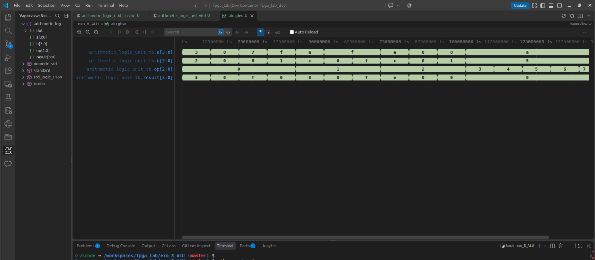
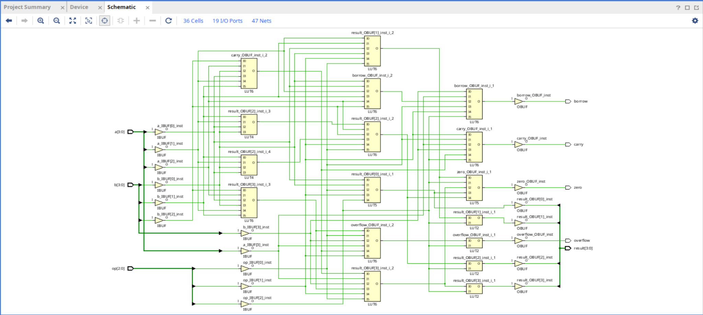
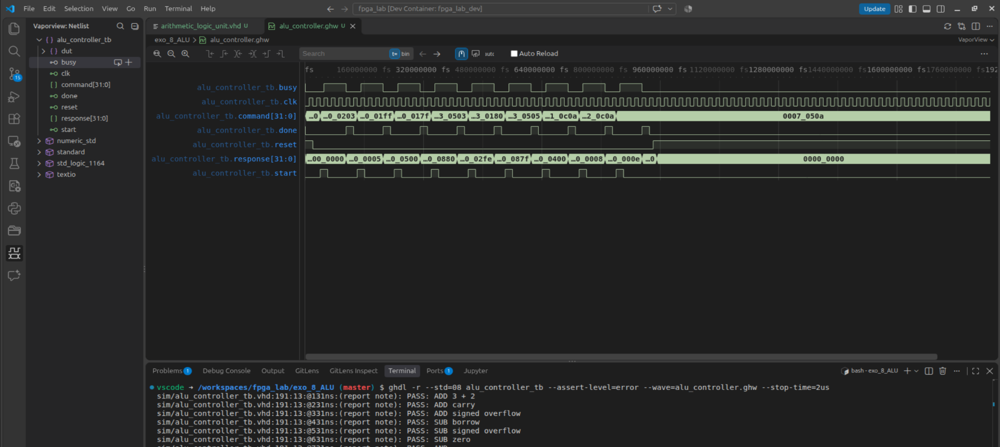
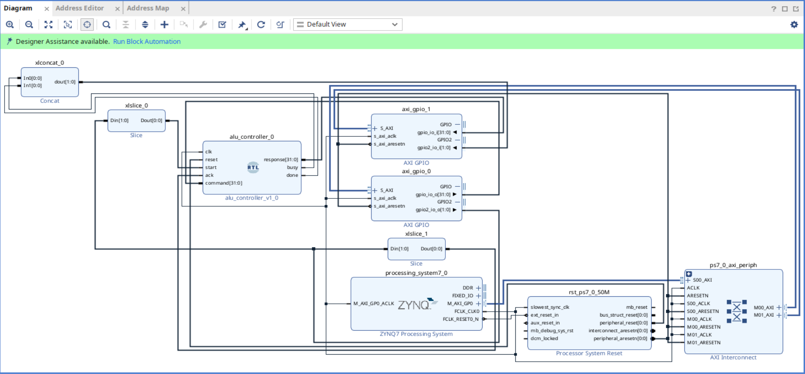
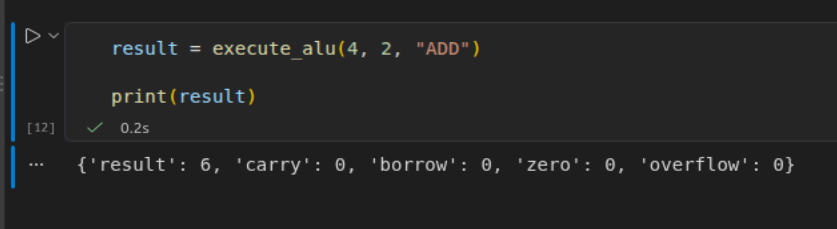

# Exercise 8 — 8-bit ALU
 
> **Platform:** PYNQ-Z2, Zynq-7020 (`xc7z020clg400-1`)  
> **Tools:** VHDL 2008, GHDL, waveform viewer, Vivado 2024.1, PYNQ/Python, VS Code + remote Jupyter   


## 1. Objective and Development Approach

The exercise involved building a **parameterizable ALU**, verifying its behavior through simulation, adding registers around it, developing a **finite-state-machine controller**, and connecting it to the PYNQ-Z2's ARM processor through **AXI GPIO** interfaces. The final goal was to control calculations directly from a Python notebook running on the board.

The approach was incremental:

```text
Combinational VHDL (ALU)
    |
    +--> GHDL testbench: operations, flags, exhaustive cases
    |
    v
Synchronous wrapper (input and output registers)
    |
    +--> Simulation + Vivado resource and timing analysis
    |
    v
FSM controller (start / busy / done / ack)
    |
    +--> Protocol, reset, and successive-operation simulation
    |
    v
Zynq Block Design: PS7 -> AXI -> GPIO -> controller -> ALU
    |
    +--> Synthesis / place and route / timing
    |
    v
Bitstream loaded through Vivado (JTAG)
    |
    v
Python notebook running on ARM (remote Jupyter)
    |
    +--> MMIO writes / reads
    +--> ADD, SUB, AND, OR, carry, borrow, zero, overflow
```

**Central principle:** Successful RTL simulation, timing closure, and correct operation of the physical system are distinct, complementary forms of evidence.

## 2. Concepts Covered

- **Combinational and sequential logic:** The ALU computes combinationally; registers and the FSM determine when data is sampled and made available.
- **VHDL generics:** `DATA_WIDTH` allows different widths to be tested; the final integration uses 8 bits.
- **Binary arithmetic:** Truncation modulo `2^8`, addition/subtraction, carry, and borrow.
- **Signed versus unsigned arithmetic:** The `overflow` flag indicates two's-complement overflow, which is different from `carry`.
- **Structured testing:** Testbenches, nominal and boundary scenarios, flag checks, and assertions.
- **Synchronous registers:** Deterministic latency; an active-high reset that is synchronous in the wrapper.
- **FSM and protocol:** `start`, `busy`, `done`, and `ack`; `done` remains latched so software running much more slowly than the PL clock can observe it.
- **Timing analysis:** Clock period, setup/hold, WNS/TNS/WHS, constraint coverage, and the critical path after routing.
- **PS/PL:** ARM processor (PS) and programmable logic (PL), `FCLK_CLK0`, PS7 reset, and the AXI GP0 interface.
- **AXI4-Lite and MMIO:** Memory-mapped registers, `DATA` and `TRI` registers, and access through `pynq.MMIO`.
- **Deployment:** Loading a Vivado bitstream through JTAG versus using `.bit`/`.hwh` files with `Overlay()`; the latter was not necessary for the initial MMIO tests.
- **Execution environments:** VS Code can display a local notebook while sending its cells to the **board's remote Jupyter server**.

## 3. ALU Block: Design and Flags

**Entity:** `alu` in `src/arithmetic_logic_unit.vhd`. Its generic interface accepts `a`, `b`, and `op`, and provides `result`, `carry`, `borrow`, `zero`, and `overflow`.

| `op[2:0]` | Operation | Purpose |
|---|---|---|
| `000` | ADD | `a + b` |
| `001` | AND | `a AND b` |
| `010` | OR | `a OR b` |
| `011` | SUB | `a - b` |
| Other values | Default behavior | Result set to zero as defined by the RTL |

Representative 8-bit examples:

```text
255 + 1 = 256 -> result=0x00, carry=1, zero=1, overflow=0
127 + 1 = 128 -> result=0x80, carry=0, overflow=1
  3 - 5 =  -2 -> result=0xFE, borrow=1
128 - 1 = 127 -> result=0x7F, overflow=1
```

The **zero flag** is determined from the result truncated to the data width. Computing `overflow` requires **signed** reasoning: for example, adding two positive operands and obtaining a negative sign bit indicates overflow.

**GHDL validation reported:** Exhaustive ADD/SUB tests (533 cases at 4 bits and 131,093 cases at 8 bits), all passing according to the reported output. Screenshots `01` and `02` illustrate the corresponding waveforms; the test counts come from the execution.



*Figure 1 — Waveforms observed during simulation.*

## 4. Why Add a Register Wrapper?

A purely combinational ALU has no sampling protocol and does not independently determine when software can consider the result stable. The `alu_register_wrapper` introduced an input register stage (`a`, `b`, and `op`) and an output register stage (`result` and flags).

```text
               clk / reset
                   |
                   v
        +-------------------+
 a ---->| A register        |
 b ---->| B register        |
 op --->| OP register       |
        +-------------------+
                   |
                   v
              +---------+
              |   ALU   |  <- combinational calculation
              +---------+
                   |
                   v
        +-------------------+
        | output registers  |
        | result + flags    |
        +-------------------+
                   |
                   v
                 output
```

The wrapper was simulated at **4-bit and 8-bit** widths, with nine targeted tests for each width according to the discussion. An initial Vivado analysis of the 8-bit wrapper reported **31 flip-flops, 38 LUTs, and 6 CARRY4 blocks**, with routed timing of **WNS +14.378 ns / WHS +0.216 ns** at 50 MHz. These figures describe the **standalone wrapper**, not the final Block Design.



*Figure 2 — Schematic view of the synthesized hardware.*

## 5. State Machine and Software/Hardware Contract

The `alu_controller` block receives a 32-bit command and handles the cycles required to operate the synchronous wrapper. The chosen protocol avoids requiring the processor to detect a 20 ns `done` pulse.

```text
             start
  +------+ --------> +------+
  | IDLE |            | LOAD |
  +------+            +------+
     ^                   |
     |                   v
     |             +-------------+
     |             | WAIT_RESULT |
     |             +-------------+
     |                   |
     |                   v
     |               +---------+
     |               | CAPTURE |
     |               +---------+
     |                   |
     |                   v
     |    ack        +-----------+
     +---------------| DONE_WAIT |
                     +-----------+
                       done = 1
```

- `IDLE`: Waits for a new `start`.
- `LOAD`: Starts the transaction through the registered wrapper.
- `WAIT_RESULT`: Allows the required synchronous cycles to elapse.
- `CAPTURE`: Copies the result and flags into the response.
- `DONE_WAIT`: Holds `done=1` until `ack`.
- `busy` is asserted during processing; an additional `start` during an operation is ignored.

The controller testbench covered **12 scenarios**, including basic operations, `start` while `busy`, reset during a transaction, and recovery after reset, and was reported as passing. For the routed standalone controller, the recorded measurements were **42 Slice LUTs, 65 FDREs, 6 CARRY4 blocks, WNS +15.323 ns, and WHS +0.151 ns** at 50 MHz.



*Figure 3 — Controller protocol waveforms in the testbench.*

## 6. Command and Response Encoding

The two words transferred through AXI GPIO were deliberately kept simple and fixed in size.

```text
COMMAND (32 bits)
31            19 18   16 15      8 7       0
+---------------+-------+----------+---------+
| reserved      | op    | B[7:0]   | A[7:0]  |
+---------------+-------+----------+---------+

RESPONSE (32 bits)
31          12 11 10   9    8 7           0
+-------------+--+----+----+--+-------------+
| reserved    |OV|ZERO|BORR|CY| RESULT[7:0] |
+-------------+--+----+----+--+-------------+

CONTROL GPIO2 (2 bits): bit0 = START, bit1 = ACK
STATUS  GPIO2 (2 bits): bit0 = BUSY,  bit1 = DONE
```

This separation keeps the command word stable while two control pulses are issued through separate MMIO writes.

## 7. Vivado PS7–AXI–ALU Integration

The controller would have exposed too many pins if used directly as the top-level module with all its buses. Two **dual-channel AXI GPIO** peripherals were therefore inserted between the PS and the controller.

```text
                     PYNQ-Z2 / Zynq-7020
    +------------------------------------------------------+
    | Processing System (ARM / Linux / Python)             |
    |    M_AXI_GP0                                         |
    +-----------+------------------------------------------+
                | AXI transactions
                v
      +-----------------------+
      | AXI Interconnect      |<-- FCLK_CLK0 = 50 MHz
      +---------+-------------+    PS7 reset / processor reset
                |
          +-----+-------------------+
          |                         |
          v                         v
 +-------------------+    +-------------------+
 | axi_gpio_0        |    | axi_gpio_1        |
 | base 0x41200000   |    | base 0x41210000   |
 | CH1 command [31:0]|    | CH1 response[31:0]|
 | CH2 start, ack    |    | CH2 busy, done    |
 +---------+---------+    +---------^---------+
           |                        |
           v                        |
      +------------------------------------+
      | alu_controller (FSM)               |
      |    input/output registers + ALU    |
      +------------------------------------+
```

**Memory map validated in Vivado:**

| IP | Base address | Channel 1 DATA | Channel 1 TRI | Channel 2 DATA | Channel 2 TRI |
|---|---|---|---|---|---|
| `axi_gpio_0` | `0x41200000` | `+0x00` | `+0x04` | `+0x08` | `+0x0C` |
| `axi_gpio_1` | `0x41210000` | `+0x00` | `+0x04` | `+0x08` | `+0x0C` |

The `axi_gpio_0` parameters were explicitly checked in the Vivado console: `C_GPIO_WIDTH=32`, `C_GPIO2_WIDTH=2`, `C_IS_DUAL=1`, with both channels configured as fixed outputs (`C_ALL_OUTPUTS=1` and `C_ALL_OUTPUTS_2=1`). The `axi_gpio_1` channels were designed for reading the response and status.



*Figure 4 — Vivado Block Design showing PS7, AXI, GPIO, slice/concat, and controller connections.*

### A Useful Detour: The Top-Level Module and Constraints

The project initially used the old standalone top-level module, `alu_controller`, and an `alu_register_wrapper.xdc` file containing, among other constraints, `create_clock -name sys_clk -period 20.000 [get_ports clk]`. After integration into the Block Design, the clock no longer came from an external `clk` port, but from **`processing_system7_0/FCLKCLK[0]`**.

The following decisions were made:

1. Generate `design_1_wrapper.vhd` for the Block Design and set **`design_1_wrapper` as the top-level module**.
2. Keep the old XDC in the repository but **disable it for synthesis and implementation** (`USED_IN_SYNTHESIS=0`, `USED_IN_IMPLEMENTATION=0`).
3. Stop manually recreating `sys_clk` in the Block Design session.
4. Close the old implemented design and rerun synthesis and implementation for the new top-level module.
5. Do not use “Force Up-to-Date” to artificially validate previous results.

The Vivado “Save Constraints” dialog displayed when closing the old implementation session resulted from constraint changes made in that session. The cautious choice was **not to write these temporary constraints into the old XDC file**.

## 8. Synthesis, Timing, and the Final Design's Critical Path

The `report_clocks` output for the **routed `design_1_wrapper`** shows:

```text
Clock:  clk_fpga_0
Source: processing_system7_0/inst/PS7_i/FCLKCLK[0]
Period: 20.000 ns
Frequency: 50.000 MHz
Jitter: 0.600 ns
```

The final `check_timing` reported **zero** issues in the following categories: registers without clocks, unconstrained internal endpoints, I/O without delays, multiple clocks, combinational loops, and latch loops.

| Post-route measurement | Value | Interpretation |
|---|---:|---|
| **WNS (setup)** | **+13.066 ns** | Positive: setup constraints met |
| TNS | 0.000 ns | No accumulated setup violations |
| **WHS (hold)** | **+0.038 ns** | Positive, but with a small margin |
| THS | 0.000 ns | No accumulated hold violations |
| WPWS | +9.020 ns | Pulse-width requirements met |
| Required frequency | 50.000 MHz | 20 ns period |

The report stated: **“All user specified timing constraints are met.”**

The **most critical setup path** no longer passed through the ALU: it belonged to **address handling in the AXI Interconnect**, with `Data Path Delay = 6.696 ns` (2.551 ns of logic and 4.145 ns of routing). The worst hold path involved internal registers in `axi_gpio_1`, with a **+0.038 ns** margin. This margin is positive but must be recalculated after each modification and routing run.

**Timing conclusion:** The final Block Design meets the 50 MHz constraints **for this routed implementation**; this does not replace validation on the board.

## 9. Moving to the PYNQ-Z2 and Incremental Diagnosis

### 9.1 Loading the Hardware

The notebook is connected to a **remote Jupyter server on the PYNQ-Z2**.

### 9.2 System Checks Before MMIO

The checks were deliberately incremental, particularly because an MMIO access in exercise 7 had already caused the board to hang:

- `/sys/class/fpga_manager/fpga0/state`: `operating` (an indication of the manager's state, **not proof that AXI is functional**).
- `Clocks.fclk0_mhz`: **Initially 100 MHz**, then set to **50 MHz** through `Clocks.fclk0_mhz = 50.0` to match the Vivado constraint.
- PS7 registers `LVL_SHFTR_EN = 0x0000000F` and `FPGA_RST_CTRL = 0x00000000`: Consistent with enabled level shifters and no FPGA reset requested through the corresponding register; these still do not guarantee that an AXI transaction will receive a response.
- Visual inspection of the Block Design: `M_AXI_GP0`, `FCLK_CLK0`, and reset connected to the interconnect and GPIO peripherals.

### 9.3 The First Actual AXI Test

Reading `0x41200004`:

```text
GPIO command direction: 0xFFFFFFFF
```

Writing `0x00000000` to `TRI` and reading it back continued to return `0xFFFFFFFF`. This observation **was not treated as evidence that the outputs were unusable**, because both channels were configured as **fixed outputs** in the Vivado IP.

The decisive test was to write data to the command GPIO and read it back:

```text
write 0x41200000 <- 0x00000203
read  0x41200000 -> 0x00000203
```

Then, reading `axi_gpio_1`:

```text
ALU response: 0x00000000
ALU status:   0x00000000
Busy: 0
Done: 0
```

**Result:** Both peripherals responded to MMIO reads. This went beyond merely validating the Vivado schematic.

## 10. First Hardware Calculation and Multiple-Transaction Verification

The first addition was sent with:

```text
A = 3
B = 2
OP = ADD (000)
command = 0x00000203
```

The software sequence was: clear the controls, write the `command` word, pulse `start`, wait for `done`, read `response`, pulse `ack`, and then check the return to idle.

```text
ARM/Python                  AXI GPIO / controller
   |                                 |
   | -- COMMAND (A,B,OP) ----------> |
   | -- START = 1 -----------------> |  FSM processes the calculation
   | -- START = 0 -----------------> |
   | <- STATUS : DONE = 1 --------- |  DONE_WAIT
   | <- RESPONSE : result+flags --- |
   | -- ACK = 1 -------------------> |  return to IDLE
   | -- ACK = 0 -------------------> |
   | <- STATUS : DONE = 0 --------- |
```

**First operation on hardware:**

```text
Command:  0x00000203
Response: 0x00000005
Result:   5
Carry:    0
Borrow:   0
Zero:     0
Overflow: 0
```

An `execute_alu(a, b, op)` function then centralized the protocol. A decisive improvement was to explicitly wait for the **idle state before issuing a command** and for **`done` to clear after `ack`**, avoiding the interpretation of a previous response as a new transaction.



*Figure 5 — Example of another hardware test: `4 + 2 = 6`.*

### 10.1 Functional Tests on the Board

| Operation | Actual value | Expected value | Result |
|---|---:|---:|---|
| `ADD(3,2)` | 5 | 5 | PASS |
| `SUB(7,3)` | 4 | 4 | PASS |
| `AND(12,10)` | 8 | 8 | PASS |
| `OR(12,10)` | 14 | 14 | PASS |

These four successive calls demonstrate that the controller could **process multiple transactions in sequence**, rather than simply produce a single result after programming.

### 10.2 Flags and Boundary Cases

| Operation | Observed result | Expected asserted flag(s) | Status |
|---|---:|---|---|
| `ADD(255,1)` | 0 | `carry=1`, `zero=1` | PASS |
| `SUB(3,5)` | 254 | `borrow=1` | PASS |
| `SUB(7,7)` | 0 | `zero=1` | PASS |
| `ADD(127,1)` | 128 | `overflow=1` | PASS |
| `SUB(128,1)` | 127 | `overflow=1` | PASS |

These cases clearly distinguish `carry` (unsigned overflow) from `overflow` (signed overflow). The complete outputs, including flags that remained zero, were printed and matched expectations in these scenarios.

**Visible test summary:** 4 general operations and 5 flag scenarios passed; an initial `3+2` and another `4+2` were also executed separately. This constitutes **directed**, rather than exhaustive, hardware coverage.

## 11. Notebook: Recommended Structure After Cleanup

The initial notebook contained one-off diagnostic cells and duplicate MMIO initialization. 

A cleaned-up version, `alu_simulation_bench_clean.ipynb`, was prepared, with comments and the following organization:

```text
1. Hardware setup / assumptions
2. Clock setup (50 MHz)
3. AXI GPIO MMIO initialization
4. ALU driver (execute_alu)
5. Python reference model
6. Directed hardware tests
7. Optional randomized hardware tests
```

Recommendations for a reusable notebook: Do not automatically reload the bitstream when already using JTAG; define addresses as constants; avoid rerunning an old cell that redefines the driver; compare `result` and all four flags; keep large test campaigns optional; and log errors with the command word and the status read back.

A **Python timeout** protects the polling loop if each MMIO access returns, but does not guarantee recovery from a hardware-level AXI transaction hang.

## 12. Reasoning Summary and Issues Resolved

| Problem / question | Observation | Reasoning and solution |
|---|---|---|
| Combinational ALU lacks a software-facing protocol | No transaction event | Add registers, followed by an FSM with a handshake |
| `done` is too brief at 50 MHz | Linux can miss a 20 ns pulse | Hold `done` until `ack` |
| Too many I/O pins with a direct top-level module | Wide controller interface | Use two dual-channel AXI GPIO peripherals |
| Old `create_clock` used with the Block Design | Clock now generated by PS7 | Generate the top-level wrapper and disable the old XDC |
| Linux clock at 100 MHz, design at 50 MHz | Mismatched values | Set `FCLK0` to 50 MHz before accessing the peripherals |
| `.bit`/`.hwh` files absent on Linux | Bitstream sent through Vivado | Understand the difference between JTAG and Overlay |
| TRI returns `0xFFFFFFFF` after writes | AXI GPIO channels configured as fixed outputs | Test the actual `DATA` register rather than drawing a premature conclusion |
| Risk of stale `done` between transactions | Several calls in quick succession | Wait for `idle` before and after each operation |
| How can hardware operation be demonstrated? | Simulations alone are insufficient | Read actual responses and flags through MMIO |

## 13. Limitations and Next Steps

1. **Hardware coverage:** The observed tests are conclusive for the cases exercised, but do not replace a randomized or exhaustive campaign covering every operand/opcode combination.
2. **PS7 initialization:** In this JTAG setup, the clock was adjusted manually; a complete PYNQ overlay could provide more reproducible deployment, provided that matching `.bit` and `.hwh` files are available.
3. **DDR / FIXED_IO:** The Block Design screenshots alone do not establish that the PS7 preset is correct or that these interfaces are exported exactly as required in the wrapper; nevertheless, successful Linux startup and AXI transactions demonstrate an operational PS–PL chain for the tests performed.
4. **Software robustness:** Document behavior after a timeout, reset, or Jupyter restart; do not promise that Python polling can recover a stalled AXI bus.
5. **Educational extensions:** Extract the Python driver into a module, add unit tests for its reference model, run reproducible randomized campaigns, and potentially measure AXI control latency and throughput.
6. **Optimizations:** The complete design's critical path lies in AXI; do not automatically attribute its delays to the ALU. Every new implementation requires a new `report_timing_summary`.

## 14. Selected Screenshot Index

| File | Content | Reason for inclusion |
|---|---|---|
| [`01_alu_waveform.png`](assets/01_alu_waveform.png) | ALU simulation / waveform | Illustrate RTL verification |
| [`02_wrapper_waveform.png`](assets/02_wrapper_waveform.png) | Another waveform | Show signals during the recorded tests |
| [`03_alu_synthesized_schematic.png`](assets/03_alu_synthesized_schematic.png) | Synthesized logic schematic | Visualize the transition from RTL to gates/registers |
| [`04_controller_schematic.png`](assets/04_controller_schematic.png) | Controller schematic / associated logic | Illustrate structures produced by synthesis |
| [`05_controller_tb_waveform.png`](assets/05_controller_tb_waveform.png) | FSM waveforms | Show `start`, states, and outputs during simulation |
| [`06_controller_implemented_schematic.png`](assets/06_controller_implemented_schematic.png) | Earlier standalone implementation | Explain the transition to the PS–PL architecture |
| [`07_block_design_vivado.png`](assets/07_block_design_vivado.png) | Final Block Design | Provide an essential overview of the hardware architecture |
| [`08_hardware_addition_success.png`](assets/08_hardware_addition_success.png) | Notebook / actual result | Provide visual evidence of an operation on the PYNQ-Z2 |

## 15. Conclusion

Exercise 8 covered a complete small-scale FPGA development cycle: **VHDL design → testbench → synchronous integration → FSM protocol → AXI interconnection → synthesis/implementation/timing → JTAG programming → software validation on ARM**.

The most significant result is not simply `3 + 2 = 5`, but the fact that the hardware **processes successive operations through a consistent command-and-acknowledgment protocol**, while flags and boundary cases behave as expected on the board. The final design meets the timing constraints defined at 50 MHz for the analyzed routing run.
