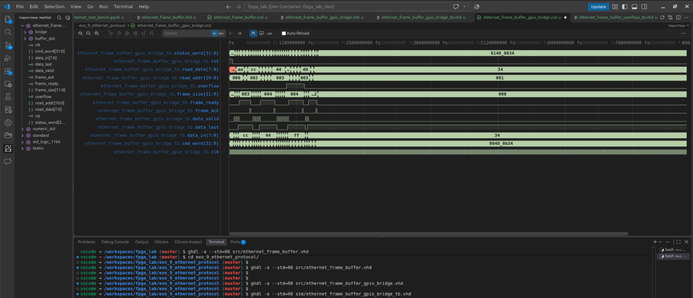
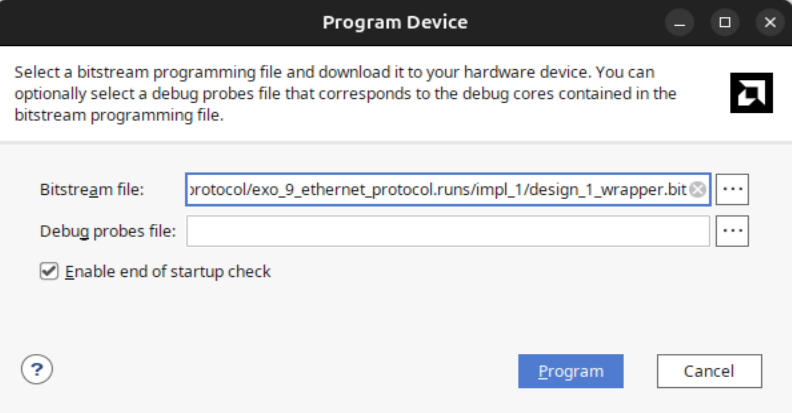
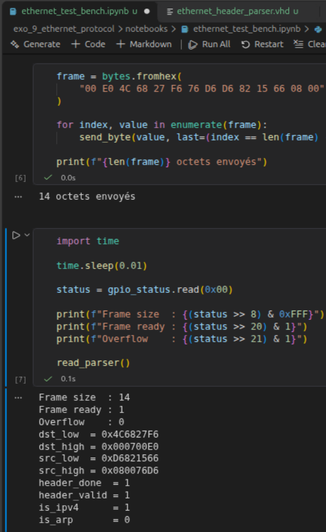

# Exercise 9 — Ethernet Frame Buffer and Header Parser on FPGA

**Repository:** `fpga_lab/exo_9_ethernet_protocol`  
**Target board:** PYNQ-Z2 (Xilinx Zynq-7020, `xc7z020clg400-1`)  
**Tools:** VHDL, GHDL, Vivado 2024.1, Python/Jupyter, PYNQ MMIO  
**Status:** RTL simulation and selected hardware tests completed successfully.

## 1. Objective

Build a small Ethernet-processing datapath inside the programmable logic (PL).

- Store incoming bytes in a **2,048-byte buffer** implemented with FPGA memory.
- Extract the **destination MAC**, **source MAC**, and **EtherType**.
- Recognize **IPv4 (`0x0800`)** and **ARP (`0x0806`)**.
- Reject incomplete headers and frames that overflow the buffer.
- Expose parsed information to Python running on the Zynq processing system (PS).
- Verify the design first with **GHDL**, then on the physical **PYNQ-Z2**.

> **Scope:** This exercise injects Ethernet-shaped byte sequences from Python through
> AXI GPIO. It does **not** receive raw frames directly from the RJ45 connector.
> Only the 14-byte Ethernet II header is parsed; IP and ARP payloads are not decoded.

## 2. Concepts practiced

| Topic | What was practiced |
| --- | --- |
| Ethernet II | Destination/source MAC addresses; 16-bit EtherType; 14-byte header |
| Synchronous RTL | Clocked state machines, resets, valid/last handshakes |
| Memory | A byte-addressable, 2,048-byte frame buffer using inferred FPGA RAM |
| PS/PL communication | AXI GPIO, 32-bit MMIO control/status words |
| Synchronization | Toggle-based request/acknowledgment protocol |
| Defensive parsing | Minimum header length, buffer overflow and validity flags |
| Verification | GHDL testbenches, Vivado synthesis/implementation, real FPGA tests |
| Integration | Vivado IP Integrator block design and AXI address assignment |

## 3. Overall architecture

```text
               Zynq Processing System (PS)
       +-----------------------------------------+
       | Python / Jupyter                        |
       |   - construct test Ethernet frames      |
       |   - write commands via PYNQ MMIO        |
       |   - read status and parsed registers    |
       +-------------------+---------------------+
                           |
                 AXI GP0 / AXI GPIO
                           |
  +------------------------v-------------------------------+
  |             Programmable Logic (PL)                    |
  |                                                        |
  | AXI GPIO #0 (command)        AXI GPIO #1 (status)       |
  |        |                            ^                  |
  |        v                            |                  |
  |  +--------------------+             |                  |
  |  | GPIO bridge        +-------------+                  |
  |  | send/ack/read      |                                |
  |  +----------+---------+                                |
  |             | byte, valid, last                        |
  |             +--------------------+                     |
  |             |                    |                     |
  |             v                    v                     |
  |  +-------------------+   +----------------------+       |
  |  | Frame buffer      |   | Ethernet header      |       |
  |  | 2048 bytes (RAM)  |-->| parser (status/ack)  |       |
  |  | size/ready/       |   | MAC + EtherType      |       |
  |  | overflow          |   | done/valid/IPv4/ARP  |       |
  |  +-------------------+   +----------+-----------+       |
  |                                     |                   |
  |                           +---------v----------+        |
  |                           | Parser registers   |        |
  |                           | 4 x 32-bit words   |        |
  |                           +---------+----------+        |
  |                                     |                   |
  |                           AXI GPIO #2 and #3           |
  +-------------------------------------+-------------------+
                                        |
                                   Python MMIO
```

The bridge broadcasts incoming bytes to the buffer and parser.
The parser also receives the buffer's `frame_ready`, `frame_size`, and `overflow` signals.

### Vivado integration


*Selected view of the implemented Vivado block design.*

## 4. VHDL modules

### `ethernet_frame_buffer.vhd`

- Accepts `data_in[7:0]`, `data_valid`, and `data_last`.
- Holds up to **2,048 bytes** in its frame memory.
- Exposes `frame_size`, `frame_ready`, `overflow`, and an addressable read port.
- Keeps a completed frame until `frame_ack` releases it.
- Detects the extra byte when a frame exceeds the available capacity.

### `ethernet_frame_buffer_gpio_bridge.vhd`

- Converts Python-written 32-bit command words into one-byte stream operations.
- Uses toggles to distinguish successive **send**, **read**, and **ACK** requests.
- Exposes matching `*_seen` status bits, allowing Python to poll for completion.
- Maps buffer data and status to a 32-bit AXI GPIO input word.

### `ethernet_header_parser.vhd`

- Captures the first 6 bytes as the destination MAC.
- Captures the next 6 bytes as the source MAC.
- Captures the last 2 header bytes as the EtherType.
- Reports `header_done` when a frame has completed.
- Asserts `header_valid` only for a complete header without overflow.
- Classifies valid `0x0800` frames as IPv4 and valid `0x0806` frames as ARP.
- Clears its state when the frame is acknowledged.

### `ethernet_parser_registers.vhd`

- Packs the parsed fields and flags into four 32-bit registers.
- Makes the results readable through two dual-channel AXI GPIO blocks.

## 5. Ethernet II header layout

```text
Byte offset        0                 6                12      14
                   |                 |                 |       |
                   +-----------------+-----------------+-------+
                   | Destination MAC | Source MAC      | Type  |
                   | 6 bytes         | 6 bytes         | 2 B   |
                   +-----------------+-----------------+-------+

Example (IPv4): 00 E0 4C 68 27 F6 | 76 D6 D6 82 15 66 | 08 00

Destination MAC : 00:E0:4C:68:27:F6
Source MAC      : 76:D6:D6:82:15:66
EtherType       : 0x0800 (IPv4)
```

Ethernet II requires **14 bytes** for this header.
A ten-byte input is therefore incomplete, even though some MAC bytes are available.

## 6. Memory-mapped interface

The addresses below are from the tested Vivado design.
Offsets are relative to each AXI GPIO base address.

| AXI GPIO | Base address | Offset | Purpose |
| --- | --- | --- | --- |
| GPIO #0 | `0x41200000` | `0x00` | 32-bit command word (output) |
| GPIO #1 | `0x41210000` | `0x00` | 32-bit buffer/bridge status (input) |
| GPIO #2 | `0x41220000` | `0x00` / `0x08` | `dst_low` / `dst_high` |
| GPIO #3 | `0x41230000` | `0x00` / `0x08` | `src_low` / `src_high` |

GPIO channel direction (TRI) registers reside at `0x04` and `0x0C`.
Configure the command GPIO as output and the status/parser GPIOs as input.

### Command word — GPIO #0

```text
 bit  7:0   data_byte     byte to send
 bit    8   data_last     mark final byte
 bit    9   send_toggle   new byte request when toggled
 bit   10   ack_toggle    release completed frame when toggled
 bits 21:11 read_addr     RAM byte address
 bit   22   read_toggle   new RAM read request when toggled
```

### Status word — GPIO #1

```text
 bits  7:0   read_data    RAM read result
 bits 19:8   frame_size   number of buffered bytes
 bit     20  frame_ready  completed frame available
 bit     21  overflow     capacity exceeded
 bit     22  send_seen    bridge completed send toggle
 bit     23  ack_seen     bridge completed ACK toggle
 bit     24  read_seen    bridge completed read toggle
```

**Important:** Maintain each toggle between operations.
Do not reset the software toggle variables between successive frame transfers unless they are first synchronized with the observed `*_seen` bits.

### Parsed field registers

```text
GPIO #2 ch1  dst_low  : destination MAC bits [31:0]
GPIO #2 ch2  dst_high : destination MAC bits [47:32] in [15:0],
                       header_done [16], header_valid [17],
                       is_ipv4 [18], is_arp [19]
GPIO #3 ch1  src_low  : source MAC bits [31:0]
GPIO #3 ch2  src_high : source MAC bits [47:32] in [15:0],
                       EtherType in [31:16]
```

The MAC fields are retained for inspection even when a frame is invalid.
Always check **`header_valid`** before using them as valid parsed results.

## 7. Verification procedure

### Step A — VHDL simulation with GHDL

- Simulate the frame buffer and GPIO bridge behavior.
- Test the header parser with IPv4 and ARP test vectors.
- Test an incomplete header and an oversized frame.
- Check output flags, MAC fields, and reset/ACK behavior.
- All the dedicated parser testbench scenarios passed.



*Screenshot captured during the simulation and RTL verification phase.*

### Step B — Vivado and FPGA programming

- Import the VHDL sources into Vivado IP Integrator.
- Connect the Zynq PS, AXI interconnect, GPIO IP, bridge, RAM and parser.
- Validate the block design and generate the FPGA bitstream.
- Use Vivado **Hardware Manager → Program Device** to load the bitstream.
- Run the MMIO tests from Python/Jupyter on the PYNQ-Z2.



*Programming the FPGA with the exercise bitstream.*

The implemented design met its 50 MHz timing target.
The reported implementation used approximately 1,005 LUTs, 2,417 flip-flops and 1 RAMB18.

### Step C — Hardware results

| Scenario | Bytes | Buffer result | Parser result | Outcome |
| --- | ---: | --- | --- | --- |
| IPv4 header | 14 | `size=14, ready=1, overflow=0` | `done=1, valid=1, IPv4=1, ARP=0` | PASS |
| ARP header | 14 | `size=14, ready=1, overflow=0` | `done=1, valid=1, IPv4=0, ARP=1` | PASS |
| Short frame | 10 | `size=10, ready=1, overflow=0` | `done=1, valid=0, IPv4=0, ARP=0` | PASS |
| Overflow frame | 2,049 | `size=2048, ready=1, overflow=1` | `done=1, valid=0, IPv4=0, ARP=0` | PASS |
| ACK after processing | — | `ready=0, overflow=0` | Registers and flags reset to zero | PASS |

#### IPv4 result — full register values

```text
Frame size   : 14
Frame ready  : 1
Overflow     : 0
dst_low      : 0x4C6827F6
dst_high     : 0x000700E0
src_low      : 0xD6821566
src_high     : 0x080076D6
header_done  : 1
header_valid : 1
is_ipv4      : 1
is_arp       : 0
```



*Actual Jupyter output recorded after sending 14 Ethernet header bytes to the FPGA.*

#### ARP result

Test header:

```text
FF FF FF FF FF FF 12 34 56 78 9A BC 08 06
```

Observed:

```text
Frame size   : 14
Frame ready  : 1
Overflow     : 0
dst_low      : 0xFFFFFFFF
dst_high     : 0x000BFFFF
src_low      : 0x56789ABC
src_high     : 0x08061234
header_done  : 1
header_valid : 1
is_ipv4      : 0
is_arp       : 1
```

#### Short-frame result

Only ten bytes were sent.
The buffer accepted the frame but the parser rejected the incomplete header:

```text
Frame size   : 10
Frame ready  : 1
Overflow     : 0
dst_low      : 0x4C6827F6
dst_high     : 0x000100E0
src_low      : 0x76D6D682
src_high     : 0x00000000
header_done  : 1
header_valid : 0
is_ipv4      : 0
is_arp       : 0
```

#### Buffer overflow result

The test sent **2,049 bytes** to a buffer with **2,048-byte capacity**.
The buffer capped its stored size and asserted `overflow`.

```text
Bytes sent   : 2049
Frame size   : 2048
Frame ready  : 1
Overflow     : 1
dst_low      : 0x4C6827F6
dst_high     : 0x000100E0
src_low      : 0xD6821566
src_high     : 0x080076D6
header_done  : 1
header_valid : 0
is_ipv4      : 0
is_arp       : 0
```

Although `EtherType=0x0800` was captured, the parser correctly **invalidated** the frame.
A subsequent ACK cleared `frame_ready`, `overflow`, and all parser registers/flags.

## 8. Reproducible Python pattern

The following example assumes the MMIO devices are instantiated.
It illustrates the send toggle protocol; the notebook used for testing also reads the four parser words.

```python
from pynq import MMIO
import time

cmd = MMIO(0x41200000, 0x1000)
status_reg = MMIO(0x41210000, 0x1000)
dst = MMIO(0x41220000, 0x1000)
src = MMIO(0x41230000, 0x1000)

cmd.write(0x04, 0x00000000)
status_reg.write(0x04, 0xFFFFFFFF)
for gpio in (dst, src):
    gpio.write(0x04, 0xFFFFFFFF)
    gpio.write(0x0C, 0xFFFFFFFF)

send_toggle = (status_reg.read(0) >> 22) & 1
ack_toggle = (status_reg.read(0) >> 23) & 1

def send_byte(value, last=False):
    global send_toggle
    send_toggle ^= 1
    cmd_word = ((value & 0xff) | (int(last) << 8)
                | (send_toggle << 9) | (ack_toggle << 10))
    cmd.write(0, cmd_word)
    for _ in range(10000):
        if ((status_reg.read(0) >> 22) & 1) == send_toggle:
            return
    raise TimeoutError("FPGA did not acknowledge byte")

# ACK a previously completed frame before starting, if needed.
def acknowledge_frame():
    global ack_toggle
    ack_toggle ^= 1
    cmd.write(0, (send_toggle << 9) | (ack_toggle << 10))
    for _ in range(10000):
        s = status_reg.read(0)
        if ((s >> 23) & 1) == ack_toggle:
            return
    raise TimeoutError("FPGA did not acknowledge ACK")

if (status_reg.read(0) >> 20) & 1:
    acknowledge_frame()

frame = bytes.fromhex("00 E0 4C 68 27 F6 76 D6 D6 82 15 66 08 00")
for i, byte in enumerate(frame):
    send_byte(byte, last=(i == len(frame) - 1))

time.sleep(0.01)
s = status_reg.read(0)
print("frame_size:", (s >> 8) & 0xfff)
print("frame_ready:", (s >> 20) & 1)
print("overflow:", (s >> 21) & 1)
print("dst_low:", hex(dst.read(0)))
print("dst_high:", hex(dst.read(8)))
print("src_low:", hex(src.read(0)))
print("src_high:", hex(src.read(8)))

# ACK after inspecting the output.
acknowledge_frame()
```

**Note:** The Python loop sends one byte at a time through MMIO.
It is suitable for learning and functional tests, not for line-rate Ethernet capture.

## 9. What this exercise does not do yet

- No direct hardware receive path from the physical RJ45 connector.
- No Ethernet PHY/MAC interface implemented in the PL.
- No parsing of VLAN tags, IPv4 fields, ARP payloads or CRC/FCS.
- No network-line-rate, AXI DMA or AXI-Stream performance testing.

A useful next exercise is to **capture Ethernet frames with Linux on the PS**,
feed their bytes through the current bridge, and compare the FPGA decoder with a software decoder.

A later version can investigate DMA/streaming interfaces for higher throughput.

## 10. Documentation files

```text
exo_9_ethernet_protocol_documentation/
├── README.md
└── assets/
    ├── fpga_programming.png
    ├── ghdl_simulation.png
    ├── ipv4_hardware_test.png
    └── vivado_block_design.png
```

This archive contains **documentation and selected screenshots**, not the complete Vivado project.
The original VHDL design and project sources remain in the `exo_9_ethernet_protocol` exercise directory.
