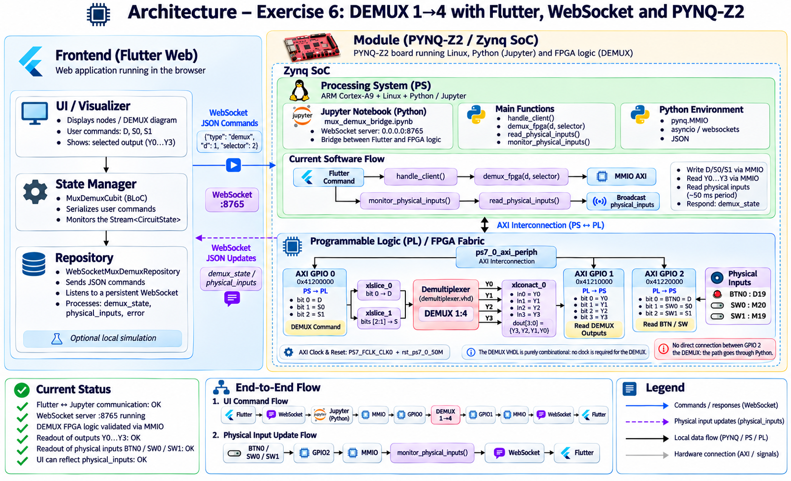

# MUX / DEMUX Visualizer

Flutter Web visualizer for the PYNQ-Z2 FPGA lab exercises, with local simulation and a live WebSocket connection to a PYNQ-Z2.

The current hardware integration focuses on **Exercise 6 — DEMUX 1→4**:

- Flutter Web provides the visualizer and controls.
- A Python/Jupyter notebook runs on the PYNQ-Z2 Processing System (PS).
- WebSocket messages connect Flutter to the PYNQ-Z2 on port `8765`.
- Python accesses the FPGA fabric through MMIO and AXI GPIO.
- The DEMUX itself is implemented in VHDL in the Programmable Logic (PL).
- Physical inputs `BTN0`, `SW0`, and `SW1` are monitored on the board and automatically reflected in the Flutter UI.

The MUX path is still simulated in Python when using the WebSocket backend. The DEMUX path uses the real FPGA implementation.

---

## Architecture



### End-to-end structure

```text
Flutter Web
  ↓
MuxDemuxCubit
  ↓
WebSocketMuxDemuxRepository
  ↓ WebSocket :8765
PYNQ-Z2 Linux / Python / Jupyter
  ↓ MMIO / AXI
Programmable Logic
  ↓
VHDL DEMUX 1→4
```

Physical input updates follow the reverse observation path:

```text
BTN0 / SW0 / SW1
  ↓
AXI GPIO 2
  ↓ MMIO
monitor_physical_inputs()
  ↓
demux_fpga(d, selector)
  ↓ MMIO write (PS → PL)
AXI GPIO 0 → slices → VHDL DEMUX → xlconcat_0
  ↓
AXI GPIO 1
  ↓ MMIO read (PL → PS)
physical_inputs WebSocket event
  ↓
WebSocketMuxDemuxRepository
  ↓ Stream<CircuitState>
MuxDemuxCubit
  ↓
Flutter UI
```

---

## Exercise 6 — DEMUX 1→4

### Logical function

The DEMUX routes input `D` to one of four outputs according to selector `S1 S0`.

| S1 | S0 | Selected output |
|---:|---:|---|
| 0 | 0 | Y0 |
| 0 | 1 | Y1 |
| 1 | 0 | Y2 |
| 1 | 1 | Y3 |

When `D = 0`, all outputs are `0`.

When `D = 1`, only the selected output becomes `1`.

---

## FPGA design

The Vivado Block Design is based on the Zynq Processing System and three AXI GPIO peripherals.

### AXI GPIO mapping

| AXI GPIO | Address | Direction | Role |
|---|---|---|---|
| `axi_gpio_0` | `0x41200000` | PS → PL | Writes `D`, `S0`, `S1` to the DEMUX |
| `axi_gpio_1` | `0x41210000` | PL → PS | Reads `Y0..Y3` from the DEMUX |
| `axi_gpio_2` | `0x41220000` | PL → PS | Reads physical `BTN0`, `SW0`, `SW1` |

### AXI GPIO 0 bit mapping

```text
bit 0 = D
bit 1 = S0
bit 2 = S1
```

The 3-bit GPIO bus is split using:

- `xlslice_0`: bit `0` → `D`
- `xlslice_1`: bits `[2:1]` → selector `S[1:0]`

### DEMUX output mapping

The VHDL outputs are concatenated through `xlconcat_0`:

```text
In0 = Y0
In1 = Y1
In2 = Y2
In3 = Y3

dout[3:0] = {Y3, Y2, Y1, Y0}
```

The resulting 4-bit bus is read through `axi_gpio_1`.

### Physical inputs

The board inputs are connected to `axi_gpio_2`:

```text
bit 0 = BTN0 = D
bit 1 = SW0  = S0
bit 2 = SW1  = S1
```

PYNQ-Z2 package pins:

```text
BTN0 = D19
SW0  = M20
SW1  = M19
```

There is intentionally **no direct hardware connection between AXI GPIO 2 and the DEMUX**.

Physical inputs are read by Python, then reapplied to the DEMUX through AXI GPIO 0. This makes Python/WebSocket the bridge between physical board controls and the Flutter application.

### Clocking

The AXI infrastructure uses:

```text
PS7 FCLK_CLK0
rst_ps7_0_50M
```

The VHDL DEMUX itself is purely combinational and does not require a clock.

---

## PYNQ notebook

Backend notebook:

```text
notebooks/mux_demux_bridge.ipynb
```

The notebook runs on the PYNQ-Z2 Processing System and provides:

- a WebSocket server on `0.0.0.0:8765`;
- MMIO access to the three AXI GPIO peripherals;
- the real FPGA DEMUX path;
- physical input monitoring;
- asynchronous `physical_inputs` events.

Important functions include:

```text
handle_client()
demux_fpga(d, selector)
read_physical_inputs()
monitor_physical_inputs()
```

### DEMUX command

Flutter can send:

```json
{
  "type": "demux",
  "d": 1,
  "selector": 2
}
```

The notebook writes the command to `axi_gpio_0`, reads the actual FPGA outputs from `axi_gpio_1`, and responds with:

```json
{
  "type": "demux_state",
  "d": 1,
  "selector": 2,
  "outputs": [0, 0, 1, 0]
}
```

### Physical input event

When `BTN0`, `SW0`, or `SW1` changes, the notebook broadcasts:

```json
{
  "type": "physical_inputs",
  "d": 1,
  "s0": 0,
  "s1": 1,
  "selector": 2,
  "outputs": [0, 0, 1, 0]
}
```

The frontend updates automatically without requiring a Flutter command.

The monitor currently polls the physical inputs at approximately `50 ms` intervals.

---

## Flutter architecture

The frontend keeps the following structure:

```text
UI / NodeGraph
    ↓
MuxDemuxCubit
    ↓
MuxDemuxRepository
    ├── LocalMuxDemuxRepository
    └── WebSocketMuxDemuxRepository
```

### Local mode

`LocalMuxDemuxRepository` performs MUX/DEMUX calculations in Dart.

No board connection is required.

### WebSocket mode

`WebSocketMuxDemuxRepository`:

- sends JSON commands;
- owns a single permanent WebSocket reader;
- handles `mux_state`;
- handles `demux_state`;
- handles spontaneous `physical_inputs`;
- handles server/protocol errors;
- publishes `Stream<CircuitState>` updates to the Cubit.

Only one raw WebSocket reader is used, avoiding competing subscriptions.

`MuxDemuxCubit` serializes user commands while continuing to receive spontaneous physical input updates.

---

## Running the Flutter application

```bash
cd flutter_mux_demux
flutter pub get
flutter run -d chrome
```

Linux desktop is also supported:

```bash
flutter run -d linux
```

The application starts in local simulation mode.

---

## Connecting to the PYNQ-Z2

Start the WebSocket server in:

```text
notebooks/mux_demux_bridge.ipynb
```

The default frontend URL is:

```text
ws://192.168.200.120:8765
```

If the PYNQ address is different:

```bash
flutter run -d chrome \
  --dart-define=WEBSOCKET_URL=ws://PYNQ_IP:8765
```

Then click **Connecter au serveur** (Connect to server) in the application.

Connecting does not automatically push old Flutter DEMUX values to the FPGA.

---

## Physical board control

With the frontend connected:

```text
BTN0 → changes D
SW0  → changes S0
SW1  → changes S1
```

The Flutter UI should update automatically.

Example:

```text
BTN0 = 1
SW1  = 0
SW0  = 1

S1 S0 = 01
selected output = Y1

Y0 = 0
Y1 = 1
Y2 = 0
Y3 = 0
```

This path has been validated end-to-end on the PYNQ-Z2.

---

## Local simulation

The UI can be used without a board.

Use **Revenir en simulation** (Return to simulation) to switch back to `LocalMuxDemuxRepository`.

Local simulation state remains independent from the remote PYNQ session.

---

## Current implementation status

Validated:

- Flutter Web UI;
- local MUX / DEMUX simulation;
- WebSocket communication between Flutter and the PYNQ notebook;
- AXI GPIO 0 MMIO writes;
- AXI GPIO 1 MMIO reads;
- AXI GPIO 2 physical input reads;
- VHDL DEMUX 1→4;
- all four selector routes;
- physical `BTN0 / SW0 / SW1` input sequences;
- spontaneous `physical_inputs` WebSocket updates;
- automatic Flutter UI updates from physical board controls.

Current limitation:

- MUX WebSocket mode is still simulated in Python;
- the DEMUX is the FPGA-backed path;
- an immediate physical input snapshot is not guaranteed on each connection.
  Until the first event, the UI shows the repository's last snapshot or initial
  values. Change a physical input to receive a new measurement. The frontend does
  not automatically call `get_physical_inputs` because its current backend
  implementation also writes to the DEMUX;
- there is no automatic reconnection, request ID, or server revision tracking.
  States follow reception order. The selector remains shared between MUX and DEMUX.

---

## Validation

Frontend:

```bash
flutter analyze
flutter test
flutter build web
```

The current WebSocket/physical-input integration includes tests for:

- spontaneous physical input events;
- physical events interleaved with command responses;
- multiple physical updates;
- invalid payloads;
- WebSocket errors and closure;
- switching back to local simulation;
- existing MUX/DEMUX behavior.

---

## Relevant project files

```text
flutter_mux_demux/
├── lib/
│   └── features/mux_demux/
│       ├── bloc/
│       ├── data/
│       ├── model/
│       └── view/
├── test/
├── pubspec.yaml
└── pubspec.lock

notebooks/
└── mux_demux_bridge.ipynb

exo_6_demultiplexer/
├── src/
│   └── demultiplexer.vhd
├── constraints/
│   ├── demultiplexer_constraint.xdc
│   └── physical_constraints.xdc
└── exo_6_demultiplexer.srcs/
    └── sources_1/bd/design_1/
        └── design_1.bd
```

`demultiplexer_constraint.xdc` belongs to the earlier direct BTN/SW/LED version of the exercise and may remain versioned even when disabled in the current Vivado configuration.

`physical_constraints.xdc` contains the current physical input mapping used by AXI GPIO 2.

---

## Notes

- `127.0.0.1` refers to the machine running the client, not automatically to the PYNQ-Z2.
- Flutter Web served over HTTPS requires a secure `wss://` endpoint.
- The server address should be reachable from the machine running the browser.
- The connection state shown by Flutter represents WebSocket transport state, not proof that a particular bitstream is loaded.
