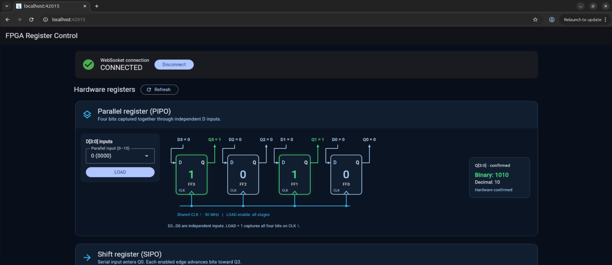
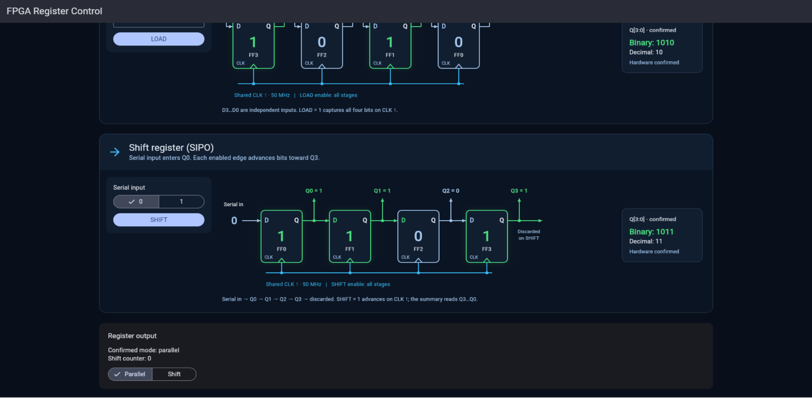

# FPGA Register Control

Flutter Web interface for observing and controlling two **4-bit VHDL registers** on a **PYNQ-Z2 (Zynq-7020)** FPGA board. The project is a companion to the FPGA register exercise in this repository and uses a Python WebSocket server running from a Jupyter notebook on the PYNQ-Z2.

The application displays hardware-confirmed register values alongside educational flip-flop circuit diagrams. It is intended as a laboratory and learning tool, not a production FPGA management service.

## Screenshots

### Parallel register (PIPO)



### Shift register (SIPO)



The screenshots show particular observed states, **not fixed expected values**. Actual values depend on the FPGA state and previously executed commands.

## Features

- Connect to and disconnect from the PYNQ-Z2 Python WebSocket server, with a `ping`/`pong` health check for the server.
- Read the current 4-bit **parallel (PIPO)** and **serial-in parallel-out (SIPO)** register values.
- Load a value from **0 to 15** into the parallel register (`LOAD`).
- Shift a serial bit (`0` or `1`) into the SIPO register (`SHIFT`).
- Select the multiplexed output mode (`parallel` or `shift`) and refresh the register snapshot.
- Display the flip-flop stages, wiring, clock/load/shift labels and hardware-confirmed output bits.
- Manage connection and register operations through independent BLoCs sharing one repository.
- Read state automatically after a successful connection or reconnection.
- Disable register controls while disconnected or waiting for an operation; retain the last confirmed snapshot on errors and label it as stale after disconnection.
- Keep diagrams legible on smaller screens with horizontal circuit scrolling.

> The existing circuit views are visual explanations of logic connections, not oscilloscopes or cycle-accurate timing diagrams. Any animated transitions must be based on confirmed server responses.

## Architecture

The Flutter application follows **UI → BLoC → Repository**. Both BLoCs use the **same** `RegisterRepository` instance, implemented by `WebSocketRegisterRepository`. The repository owns the WebSocket transport and JSON request/response correlation.


```text
+----------------------------------------------------------------------+
|                        Flutter Web application                       |
|                                                                      |
|  +--------------------------- UI ---------------------------------+  |
|  | RegisterSystemView / ConnectionView                            |  |
|  | FlipFlopWidget, ParallelRegisterWidget, ShiftRegisterWidget    |  |
|  +-------------------+-----------------------+--------------------+  |
|                      |                       |                       |
|                      v                       v                       |
|  +--------------------------- BLoC -------------------------------+  |
|  | WebSocketConnectionBloc          RegisterBloc                  |  |
|  | connect / ping / disconnect      read / LOAD / SHIFT / mode    |  |
|  +-------------------+-----------------------+--------------------+  |
|                      |                       |                       |
|                      +-----------+-----------+                       |
|                                  v                                   |
|                    RegisterRepository (interface)                    |
|                                  ^                                   |
|                                  | implements                        |
|                    WebSocketRegisterRepository                       |
|                    ONE shared WebSocket connection                   |
+----------------------------------+-----------------------------------+
                                   | ws://<PYNQ_IP>:8765
                                   | JSON requests / confirmed replies
                                   v
+----------------------------------------------------------------------+
| PYNQ-Z2 (Zynq-7020)                                                  |
|  Jupyter notebook: Python WebSocket server                           |
|  Authentication + serialized hardware commands + MMIO                |
|                                   |                                  |
|                                   v                                  |
|                         AXI GPIO (PL via PS)                         |
|                                   |                                  |
|                                   v                                  |
|                  register_command_adapter (VHDL)                     |
|                                   |                                  |
|                    +--------------+--------------+                   |
|                    v                             v                   |
|           4-bit parallel PIPO           4-bit shift SIPO             |
|                    +--------------+--------------+                   |
|                                   v                                  |
|                  mode-select multiplexer -> q[3:0]                   |
+----------------------------------------------------------------------+
```

`RegisterApp` provides the repository once through `RepositoryProvider` and injects it into both BLoCs using `MultiBlocProvider`. The app owns its disposal; reusable circuit widgets receive presentation values through constructor parameters and do not access the repository. Only the Python notebook performs MMIO.

**Connection health is not hardware health:** a successful WebSocket handshake and `pong` show that the Python server is responsive; a hardware register snapshot confirms that its FPGA access succeeded for that request.

The Python server selects each register output in turn to read both values. These readings are sequential and are not an atomic simultaneous hardware sample.

## Project structure

The checked-out application uses a layer-based structure, with each BLoC grouped together with its events and state:

```text
fpga_register_control/
├── lib/
│   ├── main.dart
│   ├── bloc/
│   │   ├── websocket_connection/
│   │   │   ├── websocket_connection_bloc.dart
│   │   │   ├── websocket_connection_event.dart
│   │   │   └── websocket_connection_state.dart
│   │   └── register_system/
│   │       ├── register_bloc.dart
│   │       ├── register_event.dart
│   │       └── register_state.dart
│   ├── models/
│   ├── repository/
│   └── ui/
│       ├── views/
│       └── widgets/
├── test/
│   ├── bloc/
│   │   ├── websocket_connection/
│   │   └── register_system/
│   ├── models/
│   ├── repository/
│   ├── ui/
│   │   ├── views/
│   │   └── widgets/
│   ├── support/
│   └── widget_test.dart
├── docs/images/
├── web/
└── pubspec.yaml
```

### Responsibilities

| Layer | Responsibility |
| --- | --- |
| UI | Show confirmed register values and controls; dispatch BLoC events |
| `WebSocketConnectionBloc` | Manage connection state and server ping verification |
| `RegisterBloc` | Coordinate reads, LOAD, SHIFT and mode changes |
| `RegisterRepository` | Transport-independent command contract |
| `WebSocketRegisterRepository` | One WebSocket channel, JSON messages, errors and request IDs |
| Python notebook server | Serialize MMIO access, execute hardware commands, return snapshots |

Register operations use the existing repository abstraction:

| Event | Repository operation |
| --- | --- |
| `RegisterStateRequested` | `getState()` |
| `ParallelLoadRequested(value)` | `loadParallel(value)` |
| `ShiftRequested(bit)` | `shiftBit(bit)` |
| `RegisterModeChanged(mode)` | `selectMode(mode)` |

`RegisterBloc` processes all four event types in one submission-ordered queue. Each operation emits `loading`, followed by `ready` with the returned snapshot or `failure` with an error. Loading and failure retain the last successful snapshot; a new operation clears the previous error.

The immutable models are [`RegisterValue`](lib/models/register_value.dart), [`RegisterSnapshot`](lib/models/register_snapshot.dart), [`RegisterHistoryEntry`](lib/models/register_history_entry.dart) and [`RegisterMode`](lib/models/register_mode.dart). `RegisterValue` validates 0–15 and consistent binary/bit representations; `RegisterSnapshot` carries the two values, selected mode, shift counter, history and server metadata.

## Prerequisites

- Flutter SDK with Chrome / Flutter Web support and a bundled Dart SDK satisfying `^3.10.8` (see [pubspec.yaml](pubspec.yaml)).
- Dependencies installed with `flutter pub get`.
- A PYNQ-Z2 running the validated register overlay and the Python WebSocket notebook server.
- IP connectivity between the Flutter development computer and the board.
- The **current session token** configured by the notebook.

The server and hardware setup notebook is part of the related exercise: [Exercise 7 — register_test.ipynb](../exo_7_four_bit_register/notebooks/register_test.ipynb).

## Getting started

From the repository root:

```bash
cd fpga_register_control
flutter pub get
flutter analyze
flutter test
```

On the PYNQ-Z2, run the notebook’s overlay and hardware setup cells with the matching register overlay files available. Before starting the WebSocket server for access from another computer, change its current loopback default `WS_HOST = "127.0.0.1"` to `WS_HOST = "0.0.0.0"` on the trusted lab network, keeping `WS_PORT = 8765`. Run the server cell and keep the Jupyter kernel running while using the app. Use the session token generated by that running server.

Launch Flutter Web on the development computer:

```bash
flutter run -d chrome \
  --dart-define='WS_URL=ws://<PYNQ_IP>:8765' \
  --dart-define='WS_TOKEN=<CURRENT_SESSION_TOKEN>'
```

Replace `<PYNQ_IP>` with the board's accessible IP address and `<CURRENT_SESSION_TOKEN>` with the active session token generated by the notebook. **Do not use `0.0.0.0` as the Flutter client's destination**: it is a *server bind address*, not a remote host address.

`WS_URL` defaults to `ws://127.0.0.1:8765` and `WS_TOKEN` defaults to an empty string in [lib/main.dart](lib/main.dart). Supply both for a remote board, and restart/rebuild the app when changing these compile-time values.

Click **Connect**. The connection BLoC opens the shared connection and verifies `ping`/`pong`; the register view then automatically requests the initial hardware state. Reconnection requests a fresh snapshot as well.

- **Refresh** reads a new snapshot manually.
- Choose a parallel value from 0–15, then press **LOAD**.
- Choose serial input 0 or 1, then press **SHIFT**.
- Use **Parallel** / **Shift** to select the multiplexed register output. Both diagrams remain visible.

The notebook selects `parallel` after LOAD and `shift` after SHIFT; the UI shows the mode returned by the server. Changing an input selector changes only the candidate D input, not the confirmed Q value. Confirmed bits and mode update after a successful repository response.

Before the first successful read, Q values are unknown (`—`). During operations the UI keeps the previous snapshot and disables register commands. On failure it displays the error and keeps that snapshot. After disconnection it marks the retained values as stale, including while waiting for the reconnect refresh.

### Security note

This laboratory setup uses plain `ws://` and a session token. Restrict the server to a trusted network. In Flutter Web, `--dart-define` values are included in the client build and **must not be treated as secrets**. Do not expose this server directly to the public internet or commit real tokens to Git.

## WebSocket commands

Commands use JSON with a unique request ID and the current session token.

| Action | Additional JSON fields | Purpose |
| --- | --- | --- |
| `ping` | — | Verify Python WebSocket server responsiveness |
| `get_state` | — | Read both register outputs and metadata |
| `load_parallel` | `"value": 10` | Load four parallel bits (`0`–`15`) |
| `shift` | `"bit": 1` | Shift in one serial bit (`0` or `1`) |
| `select_mode` | `"mode": "shift"` | Select `parallel` or `shift` output |

Example request:

```json
{
  "id": "flutter-2",
  "token": "<CURRENT_SESSION_TOKEN>",
  "action": "get_state"
}
```

Example response, containing **illustrative hardware state**:

```json
{
  "id": "flutter-2",
  "type": "result",
  "state": {
    "parallel": { "value": 10, "bits": "1010", "q0_to_q3": [0, 1, 0, 1] },
    "shift": { "value": 11, "bits": "1011", "q0_to_q3": [1, 1, 0, 1] },
    "selected_mode": "parallel",
    "shift_count": 0,
    "history": [],
    "fclk0_mhz": 50.0,
    "software_reset_available": false
  }
}
```

`bits` is in **Q3 → Q0** (most significant to least significant) order; `q0_to_q3` is in **Q0 → Q3** order. Command results use values returned by the server, not locally guessed FPGA states. `shift_count` is a server-side count of SHIFT commands, not FPGA clock cycles.

A ping returns `type: "pong"` with its request ID. A failed request returns an error such as:

```json
{
  "id": "flutter-2",
  "type": "error",
  "message": "Hardware access failed"
}
```

The repository correlates replies by ID and serializes hardware reads and writes, including reads that use the shared output MUX. Request and connection timeouts default to five seconds and are configurable through the repository constructor. A hardware request timeout closes the connection and cancels unsent operations; it does not assume that the server cancelled MMIO or automatically replay the command.

The server also sends `hello` and `state_changed` notifications. The current client ignores these broadcasts rather than treating them as command replies. It refreshes on connection/reconnection, its own successful operations and manual **Refresh**; changes made by another client are not automatically pushed into the displayed snapshot.

## Register behavior and hardware notes

**PIPO (parallel-in, parallel-out):** A LOAD operation captures four independent D inputs into the corresponding flip-flops on the applicable clock edge. The 4-bit result is displayed as `Q3 Q2 Q1 Q0`.

**SIPO (serial-in, parallel-out):** Each SHIFT operation moves stored data toward Q3, adds the input bit at Q0, and discards the previous Q3. The RTL relation is:

```vhdl
stored <= stored(2 downto 0) & serial_in;
```

```text
serial_in --> D(FF0)
Q(FF0)   --> D(FF1)
Q(FF1)   --> D(FF2)
Q(FF2)   --> D(FF3)
Q(FF3)   --> discarded on SHIFT
```

All four SIPO flip-flops capture their respective D inputs on the same enabled rising clock edge. The diagram places Q0 through Q3 from left to right; the binary summary remains Q3 through Q0.

The validated FPGA design runs with **FCLK0 = 50 MHz**. That is a hardware clock configuration, not the speed at which Flutter can display transitions. Flutter displays the server’s clock metadata and does not configure FCLK0. The current hardware does **not** expose a functional software reset through this WebSocket API (`software_reset_available: false`). The Python server controls MMIO access; do not run notebook MMIO test cells concurrently with the serving session.

## Tests

```bash
flutter analyze
flutter test
```

Unit and widget tests exercise BLoC states, repository commands, model parsing and display behavior without requiring an FPGA. Real-board testing is still needed to verify the end-to-end MMIO path, loading, shifting and mode selection on the currently programmed overlay.

## Limitations and next steps

- The Jupyter-based server must remain running; a kernel restart stops its WebSocket service.
- The server reads two register outputs sequentially through a mode multiplexer.
- No software reset command is available in the validated hardware design.
- WebSocket session token and plain WS transport are intended for a trusted laboratory network.
- **Future work:** pedagogical LOAD / SHIFT / shared-clock pulse animations driven only by server-confirmed snapshots, plus further resilience and end-to-end tests. These operation animations are not implemented yet; the current flip-flop circuits are static diagrams, not real 50 MHz waveforms.

## Related project

This Flutter application accompanies the parent repository's four-bit register exercise and is not intended to replace VHDL simulation or the hardware validation notebook.
